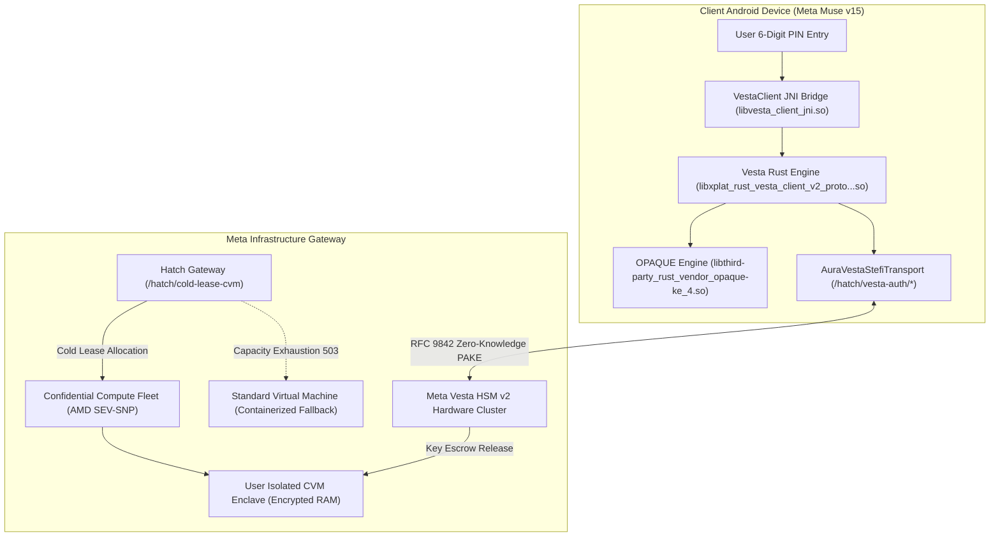
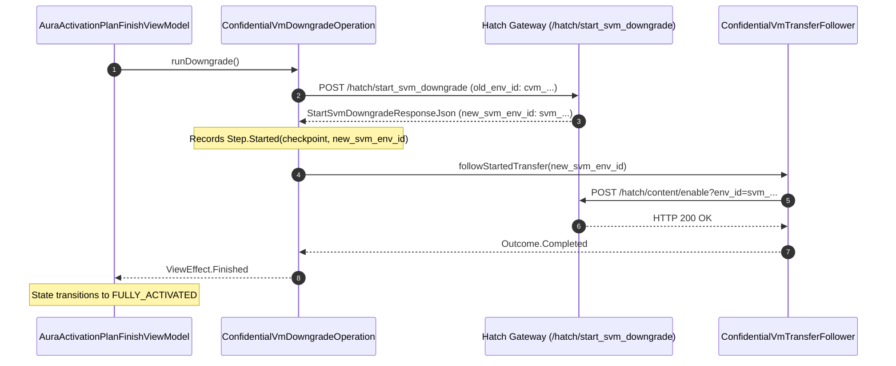

# Deep Dive Specification: Hardware Enclave CVM, Meta Vesta HSM v2 & SVM Downgrade

## 1. Overview & Threat Model

Meta Muse v15 provisions dedicated **Confidential Virtual Machines (CVM)** to execute autonomous agentic workflows and protect volatile conversational memory. Hardware memory encryption is enforced by hypervisor extensions utilizing **AMD SEV-SNP** (Secure Encrypted Virtualization-Secure Nested Paging) or **Intel TDX** (Trust Domain Extensions).

Even host operating systems, hypervisors, and Meta cloud platform administrators cannot inspect the plaintext RAM of an active virtual machine. Enclave attestation keys and recovery credentials are decoupled from raw storage through **Meta Vesta HSM v2**, an asymmetric Password-Authenticated Key Exchange (PAKE) system based on IETF RFC 9842 (OPAQUE).



---

## 2. Hardware Enclave Cold Lease (`POST /hatch/cold-lease-cvm`)

- **Class Identifier:** `com.facebook.aura.network.api.StefiHatchPath.ColdLeaseCvm`
- **Orchestrator:** `com.facebook.aura.gateway.HatchCvmColdLeaseClient`
- **Endpoint:** `POST https://hatch-api.meta.ai/hatch/cold-lease-cvm`
- **Idempotency Guarantee:** The client generates and transmits a stable `AuraDeviceId` as the `idempotency_key`. This guarantees that retry loops under unstable mobile connectivity do not trigger redundant hypervisor machine allocations.

### Request Payload (`ColdLeaseCvmRequestJson`)
```json
{
  "idempotency_key": "C92D3E1A-8B42-4A7B-901F-2B44671A39E1"
}
```

### Response Payload (`ColdLeaseCvmResponseJson`)
```json
{
  "vm_id": "cvm_us_east_4b9a8201",
  "created": true
}
```

### Decompiled Error Handling (`HatchCvmColdLeaseException`)
If the backend cannot allocate a hardware enclave, `HatchCvmColdLeaseClient` parses the error code into enum `HatchCvmColdLeaseException$Reason`:
- `CAPACITY_EXHAUSTED` / `503 enclaveExhausted`: Triggers SVM downgrade fallback.
- `AUTH_REVOKED`: Forces token re-exchange.
- `TIMEOUT`: Retries with exponential backoff.

---

## 3. Meta Vesta HSM v2: Asymmetric OPAQUE PAKE (RFC 9842)

Enclave master keys and user storage encryption are guarded by Meta's Vesta Hardware Security Module (HSM v2). Plaintext user PINs are never transmitted over the wire or stored on Meta servers.

### 1. Shipped Native Binaries in APK (`lib/arm64-v8a/`)

The v15 production APK (`com.facebook.aura` v15.0.0.3.156) ships 5 native binaries dedicated to Vesta HSM and OPAQUE operations:
1. `lib/arm64-v8a/libvesta_client_jni.so`: Android JNI bridge exposing `com.facebook.vesta.VestaClient`.
2. `lib/arm64-v8a/libxplat_rust_vesta_client_v2_proto_vesta_proto-rustAndroid.so`: Core Vesta protocol v2 Rust implementation.
3. `lib/arm64-v8a/libxplat_rust_vesta_client_proto_vesta_proto-rustAndroid.so`: Legacy protocol v1 fallback.
4. `lib/arm64-v8a/libthird-party_rust_vendor_opaque-ke_4.so`: Upstream Rust implementation of IETF RFC 9842 OPAQUE PAKE.
5. `lib/arm64-v8a/libthird-party_rust_vendor_opaque-ke_1.so`: Baseline OPAQUE primitives.

### 2. JNI Interface: `com.facebook.vesta.VestaClient`

The JNI layer executes cryptographic blinding and key derivation in native memory:
- `beginRegisterNative(byte[] pin, byte[] outMessage)`
- `finishRegisterNative(..., byte[] pkr, byte[] outVerifier)`
- `finishRegisterProtoNative(...)`
- `beginLoginNative(byte[] pin, byte[] outBlindedMessage)`
- `finishLoginNative(..., byte[] response, byte[] outSharedKey)`
- `validateHsmKeyNative(byte[] hsmKey, byte[] signature, byte[] outResult)`
- `validateHsmKeysWithOtaBundleNative(...)`

### 3. Vesta Auth REST Gateway Endpoints

The network communication between the Rust client and the Vesta HSM cluster is marshaled by `com.facebook.aura.confidentialvm.network.AuraVestaStefiTransport` over HTTP/2 using these dedicated paths:
1. `POST /hatch/vesta-auth/begin-register`: Initiates OPAQUE credential registration.
2. `POST /hatch/vesta-auth/finish-register`: Submits blinded verifier record for hardware escrow.
3. `POST /hatch/vesta-auth/begin-login`: Initiates OPAQUE login authentication challenge.
4. `POST /hatch/vesta-auth/finish-login`: Exchanges blinded signature for hardware key unwrap.
5. `GET /hatch/vesta-auth/user-info?vesta_client_api_version=2`: Retrieves current state revision and active update IDs.

### 4. Enclave Wire Schemas

#### 1. PIN Update / Creation (`PinUpdateRequestJson`)
Class: `com.facebook.aura.confidentialvm.repository.PinUpdateRequestJson`
```json
{
  "update_id": "upd_01h9e48f7a",
  "replaces_update_id": null,
  "encrypted_pin_verifier": "opaque_v2_pake_verifier_base64_blob...",
  "last_successful_entry_at_ms": 1794011607000
}
```

#### 2. PIN Confirmation (`PinConfirmRequestJson`)
Class: `com.facebook.aura.confidentialvm.repository.PinConfirmRequestJson`
```json
{
  "reminder_id": "rem_01h9e48b",
  "update_id": "upd_01h9e48f7a",
  "state_revision": 1,
  "had_wrong_guess": false,
  "last_successful_entry_at_ms": 1794011607000
}
```

#### 3. PIN State Storage (`PinStateJson`)
Class: `com.facebook.aura.confidentialvm.repository.PinStateJson`
```json
{
  "state_revision": 1,
  "update_id": "upd_01h9e48f7a",
  "replaces_update_id": null,
  "encrypted_pin_verifier": "opaque_v2_pake_verifier_base64_blob...",
  "last_successful_entry_at_ms": 1794011607000,
  "reminder_interval_days": 14
}
```

---

## 4. Standard VM (SVM) Downgrade Pipeline

If a user refuses the cryptographic PIN setup or if regional hardware enclave clusters encounter exhaustion (`HTTP 503 enclaveExhausted`), the application initiates an automated SVM downgrade.

- **Class Identifier:** `com.facebook.aura.confidentialvm.vmswitch.ConfidentialVmDowngradeOperation`
- **Path Class:** `StefiHatchPath$StartSvmDowngrade.INSTANCE`
- **Endpoint:** `POST https://hatch-api.meta.ai/hatch/start_svm_downgrade`

### Wire Request Schema (`StartCvmMigrationRequestJson`)
```json
{
  "old_env_id": "cvm_us_east_4b9a8201"
}
```

### Wire Response Schema (`StartSvmDowngradeResponseJson`)
```json
{
  "new_svm_env_id": "svm_us_east_9a3c1042"
}
```

### Downgrade Lifecycle & Execution Flow



1. **Failure Interception:** When `ColdLeaseCvm` fails or user selects Standard Compute, `ConfidentialVmDowngradeOperation` reads the active environment checkpoint.
2. **Downgrade Trigger:** Sends `old_env_id` to `/hatch/start_svm_downgrade`.
3. **Environment Handshake:** The server allocates a containerized virtual machine (`new_svm_env_id`).
4. **Data Transfer Following:** `ConfidentialVmTransferFollower` points the gateway at the destination environment (`/hatch/content/enable?env_id=...`).
5. **Resolution:** The user enters the workspace without hardware-encrypted memory boundaries, allowing full conversational functionality to proceed.
