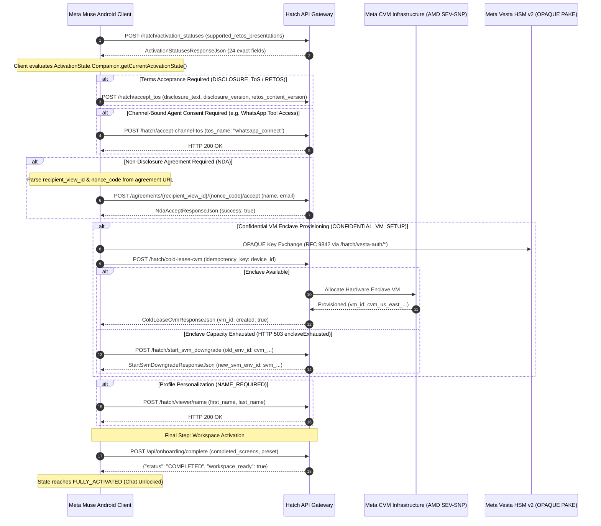
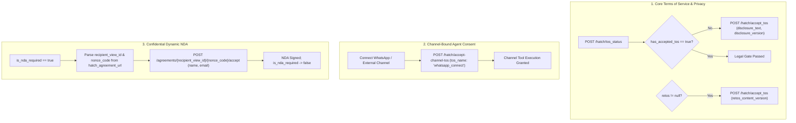

# Meta Muse v15: Lifecycle Architecture, Gatekeeper Evaluation & Onboarding

## 1. Overview & Gatekeeper Architecture

Following successful credential verification and token acquisition, an account enters the **Activation & Gatekeeper Evaluation Phase**. In Meta Muse v15 (`com.facebook.aura` v15.0.0.3.156), admission into the operational workspace is governed by a client-side deterministic state engine driven by `POST /hatch/activation_statuses`.

The runtime evaluation is executed by `com.facebook.aura.activation.data.ActivationState.Companion.getCurrentActivationState()`, which evaluates the gateway response (`ActivationStatusesResponseJson`) and secondary disclosure models (`TosStatusResponseJson`) across an 18-step evaluation pipeline resolving to 17 discrete enum states.



---

## 2. Decompiled Gatekeeper Data Models

The gatekeeper payload represents the most extensive status model in the application, containing 24 boolean, string, and nullable entity fields defined in `com.facebook.aura.user.repo.ActivationStatusesResponseJson`:

### Complete Wire Schema (`ActivationStatusesResponseJson`)

```json
{
  "has_hatch_access": true,
  "has_completed_hatch_activation": false,
  "has_cleared_acquisition": true,
  "has_provisioned_vm": false,
  "has_redeemed_invite_code": false,
  "is_in_geoblocked_region": false,
  "is_nda_required": false,
  "ccv_status": "not_required",
  "requires_name": false,
  "name_prefill": "Aura User",
  "name_dialog": null,
  "email_address_prefill": "user@example.com",
  "is_vm_type_selection_required": true,
  "is_vm_type_plan_required": false,
  "hatch_wearables_linked": false,
  "hatch_wearables_comms_consent": null,
  "invite_code_entry_available": true,
  "enter_invite_code_screen": null,
  "waitlist_available": false,
  "waitlist_status": "ACTIVATED",
  "waitlist_choice_screen": null,
  "waitlisted_screen": null,
  "waitlisted_limited_screen": null,
  "retos": null
}
```

### Complete 24-Field Specification Table

| Index | Field Name | Kotlin Type | Bytecode Semantic Mapping |
| :---: | :--- | :--- | :--- |
| **1** | `has_hatch_access` | `Boolean?` | Global product entitlement flag. If `Boolean.FALSE`, state evaluates to `NO_ACCESS`. If `null` and not activated, state is `LOADING`. |
| **2** | `has_cleared_acquisition` | `Boolean?` | Indicates introductory tutorial/welcome wizard completion. If `null`, causes `isResolvingAcquisition()` to hold state at `LOADING`. If `false`, enables waitlist/invite code routing. |
| **3** | `invite_code_entry_available` | `Boolean?` | True if the account is allowed to enter an invite redemption code. If `null`, holds at `LOADING`. |
| **4** | `waitlist_available` | `Boolean?` | True if regional capacity throttling offers a waitlist registration queue. If `null`, holds at `LOADING`. |
| **5** | `has_provisioned_vm` | `Boolean?` | True if hardware enclave CVM or fallback SVM is provisioned. When `true`, transitions directly to `FULLY_ACTIVATED`. When `false` and selection required, resolves to `CONFIDENTIAL_VM_SETUP`. |
| **6** | `waitlist_status` | `String?` | Wire status string mapped to enum `69d`: `ACTIVATED`, `ADMITTED`, `LIMITED` (`69d.A04`), `WAITLISTED` (`69d.A06`), `LEFT`, `UNSET_OR_UNRECOGNIZED_ENUM_VALUE`. |
| **7** | `has_redeemed_invite_code` | `boolean` | True if an invite code has already been redeemed by this account identity. |
| **8** | `ccv_status` | `String?` | Cross-Channel Verification status mapped to enum `9kt`: `NOT_REQUIRED`, `CCV_REQUIRED`, `BLOCKED`. |
| **9** | `has_completed_hatch_activation`| `boolean` | True if complete onboarding pipeline has finished. Bypasses intermediate loading checks. |
| **10** | `is_in_geoblocked_region` | `boolean` | Wire geo-fence indicator; converted in repository to `isPassGeogating` (`!is_in_geoblocked_region`). If false, resolves to `GEO_BLOCKED`. |
| **11** | `hatch_wearables_linked` | `boolean` | True if Meta smart glasses (Ray-Ban Meta) are paired. Used with consent flag to trigger `WEARABLES_LINKING`. |
| **12** | `hatch_wearables_comms_consent` | `String?` | Consent status string for wearable communication tools (`granted`, `pending`, `revoked`). |
| **13** | `is_nda_required` | `boolean` | Non-Disclosure Agreement gate. Evaluated at **Priority Rank 7** (before BLOCKED/CCV/ToS). Triggers `NDA` state. |
| **14** | `is_vm_type_selection_required` | `boolean` | True if user must choose compute tier (Confidential VM vs Standard VM). |
| **15** | `requires_name` | `boolean` | True if user profile missing required display names. Triggers `NAME_REQUIRED` state. |
| **16** | `is_vm_type_plan_required` | `Boolean?` | Subscription billing requirement for premium compute enclaves. |
| **17** | `name_prefill` | `String?` | Suggested display name derived from SSO account or address book. |
| **18** | `email_address_prefill` | `String?` | Suggested email address for onboarding confirmation. |
| **19** | `waitlist_choice_screen` | `OnboardingScreenCopyJson?` | Localized UI copy for waitlist option display. |
| **20** | `enter_invite_code_screen` | `OnboardingScreenCopyJson?` | Localized UI copy for invite code redemption modal. |
| **21** | `waitlisted_screen` | `OnboardingScreenCopyJson?` | Localized UI copy for standard waitlist queue surface. |
| **22** | `waitlisted_limited_screen` | `OnboardingScreenCopyJson?` | Localized UI copy for limited regional access tier. |
| **23** | `retos` | `JsonElement?` | Updated Terms of Service metadata. If non-null, immediately triggers `RETOS` at Priority Rank 1. |
| **24** | `name_dialog` | `OnboardingScreenCopyJson?` | Localized UI copy for name collection dialog. |

---

## 3. Legal Disclosure Acceptance Pipeline

Meta Muse v15 enforces a multi-tier legal disclosure pipeline across three independent API pathways:



### 1. Core Terms of Service (`POST /hatch/accept_tos`)
- **Query / Status Path:** `POST /hatch/tos_status` (`StefiHatchPath$TosStatus`) returning `TosStatusResponseJson`.
- **Submission Path:** `POST /hatch/accept_tos` (`StefiHatchPath$AcceptTos`)
- **Wire Request Schema (`AcceptTosRequestJson`):**
```json
{
  "disclosure_text": "Meta Muse Terms of Service and Privacy Policy...",
  "disclosure_version": "2026.11.01",
  "retos_content_version": null
}
```
- **Re-Consent Payload (`acceptReTos`):**
```json
{
  "disclosure_text": null,
  "disclosure_version": null,
  "retos_content_version": "2026.11.01"
}
```

### 2. Channel-Bound Consent (`POST /hatch/accept-channel-tos`)
- **Controller Class:** `com.facebook.aura.settings.WhatsAppConnectConsentRepository`
- **Path Class:** `StefiHatchPath$AcceptChannelTos.INSTANCE` (`/hatch/accept-channel-tos`)
- **Wire Request Schema (`AcceptChannelTosRequestJson`):**
```json
{
  "tos_name": "whatsapp_connect"
}
```
- **Semantics:** Authorizes agentic tool interactions (reading/sending messages, media actions) across connected channels.

### 3. Dynamic NDA Agreement (`POST /agreements/{recipient_view_id}/{nonce_code}/accept`)
- **Controller Class:** `com.facebook.aura.activation.repo.AuraActivationRepository.acceptNdaAgreement()`
- **Path Class:** `StefiHatchPath$OneClickAgreementAccept`
- **URL Resolution:** Decompiled method `parseAgreementIds()` parses `recipient_view_id` and `nonce_code` path segments dynamically from the configured `hatch_agreement_url`.
- **Wire Request Schema (`NdaAcceptRequestJson`):**
```json
{
  "name": "Jane Doe",
  "email": "janedoe@example.com"
}
```
- **Wire Response Schema (`NdaAcceptResponseJson`):**
```json
{
  "success": true
}
```

---

## 4. Hardware Enclave & Cryptographic Subsystem Summary

1. **Confidential VM Enclave Provisioning (`POST /hatch/cold-lease-cvm`):**
   - Cold-leases dedicated AMD SEV-SNP / Intel TDX virtual machines with encrypted RAM.
   - Enforces idempotency via `idempotency_key: AuraDeviceId`.
2. **Meta Vesta HSM v2 (OPAQUE PAKE RFC 9842):**
   - Implemented via `com.facebook.vesta.VestaClient` and native libraries `libvesta_client_jni.so`, `libxplat_rust_vesta_client_v2_proto_vesta_proto-rustAndroid.so`, and `libthird-party_rust_vendor_opaque-ke_4.so`.
   - Client-side zero-knowledge PIN exchangeDerives cryptographic secrets without ever exposing plaintext PINs over the wire.
   - Verifier registration and confirmation via `PinUpdateRequestJson`, `PinConfirmRequestJson`, and `PinStateJson`.
3. **Standard VM (SVM) Downgrade Pipeline (`POST /hatch/start_svm_downgrade`):**
   - Orchestrated by `ConfidentialVmDowngradeOperation`.
   - Allows graceful degradation when regional hardware enclaves encounter capacity exhaustion (`HTTP 503 enclaveExhausted`).
   - Request: `StartCvmMigrationRequestJson` (`{"old_env_id": "cvm_..."}`).
   - Response: `StartSvmDowngradeResponseJson` (`{"new_svm_env_id": "svm_..."}`).

---

## 5. Specialized Deep-Dive Sub-Dossiers

For exhaustive state transition tables and hardware enclave cryptographic specifications, consult:
- 📊 [`STATE_MACHINE_18.md`](file:///home/ubuntu/projects/beta/activation/STATE_MACHINE_18.md) — Comprehensive 17-state deterministic matrix, exact priority ranking, and bytecode triggers.
- 🛡️ [`CVM_AND_VESTA_HSM.md`](file:///home/ubuntu/projects/beta/activation/CVM_AND_VESTA_HSM.md) — Hardware Enclave CVM allocation, Meta Vesta HSM v2 (OPAQUE PAKE), and SVM downgrade fallback.
