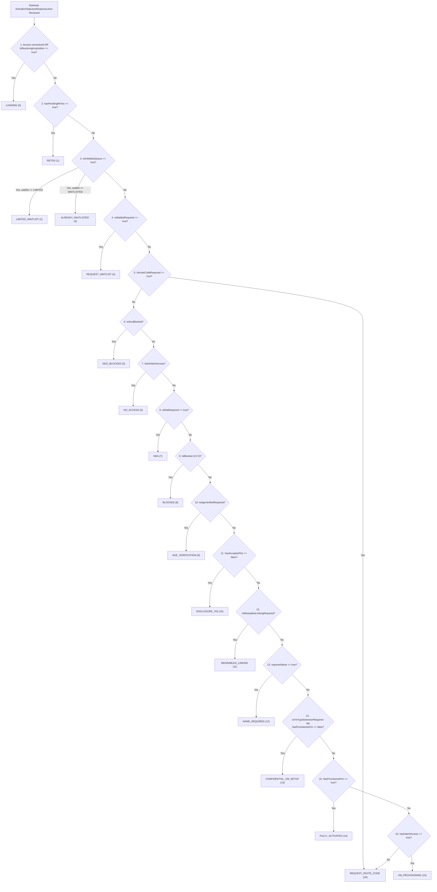

# Deep Dive Specification: The Deterministic Activation State Machine

## 1. Overview & Evaluation Architecture

The client-side activation state engine is implemented in `com.facebook.aura.activation.data.ActivationState`. The evaluation logic (`ActivationState.Companion.getCurrentActivationState()`) consumes the primary gateway payload (`ActivationStatusesResponseJson`) and legal status (`TosStatusResponseJson`) to deterministically resolve the application lifecycle into one of **17 discrete enum states** through an **18-step evaluation pipeline**.



> [!IMPORTANT]
> **Bytecode Verification Note:** The enum `ActivationState` defines exactly **17 enum states**. The introductory wizard (`has_cleared_acquisition`) does not possess a separate enum value; instead, if `has_cleared_acquisition == null` and the account is not activated, it triggers `isResolvingAcquisition() -> LOADING`. If `false`, it acts as the routing gatekeeper for waitlist admission and invite code redemption (`REQUEST_INVITE_CODE`).

---

## 2. Complete Priority Matrix & Evaluation Rules

The following table reflects the exact instruction sequence decompiled from `ActivationState$Companion.getCurrentActivationState()` in `classes4.dex`:

| Priority Rank | Enum State | Bytecode Condition | Required API Action | Next Transition / Resolution |
| :---: | :--- | :--- | :--- | :--- |
| **0** | `LOADING` | `(hasHatchAccess == null && !hasCompletedHatchActivation) \|\| isResolvingAcquisition(...)` | `POST /hatch/activation_statuses` | Await gateway response |
| **1** | `RETOS` | `hasPendingReTos == true` (`reTosPayload != null`) | `POST /hatch/accept_tos` | Submit `retos_content_version` $\to$ re-evaluate |
| **2** | `LIMITED_WAITLIST` | `isInWaitlistQueue(...) && waitlistStatus == 69d.A04` (`LIMITED`) | None (Passive display) | Wait for capacity allocation or redeem invite code |
| **3** | `ALREADY_WAITLISTED` | `isInWaitlistQueue(...) && waitlistStatus == 69d.A06` (`WAITLISTED`) | None (Passive display) | Await admission push or bypass via invite code |
| **4** | `REQUEST_WAITLIST` | `!bypass && isWaitlistRequired(...)` (`waitlistAvailable == true`) | `POST /hatch/waitlist/join` | Join waitlist queue $\to$ `ALREADY_WAITLISTED` |
| **5** | `GEO_BLOCKED` | `isGeoBlocked(isPassGeogating)` (`Boolean.FALSE.equals(isPassGeogating)`) | None (Hard block) | Must connect from whitelisted geographic territory |
| **6** | `NO_ACCESS` | `isNoHatchAccess(hasHatchAccess)` (`Boolean.FALSE.equals(hasHatchAccess)`) | None (Hard block) | Account lacks Meta Muse entitlement |
| **7** | `NDA` | `isNdaRequired == true` | `POST /agreements/{view_id}/{nonce}/accept` | Sign dynamic NDA $\to$ `is_nda_required: false` |
| **8** | `BLOCKED` | `isBlocked(ageConfirmationStatus)` (`ccv_status == "blocked"`) | None (Account suspension) | Safety/policy compliance lock |
| **9** | `AGE_VERIFICATION` | `isAgeVerifiedRequired(...)` (`ccv_status == "ccv_required"`) | IG / FB Cross-Channel WebAuth | Complete CCV verification $\to$ `not_required` |
| **10** | `DISCLOSURE_ToS` | `hasAcceptedTos == false` | `POST /hatch/accept_tos` | Accept disclosure text/version $\to$ clear legal gate |
| **11** | `WEARABLES_LINKING` | `!hasLinkedWearables && isWearableConsentEnabled` | `POST /hatch/wearables/link` | Pair Ray-Ban Meta or dismiss consent |
| **12** | `NAME_REQUIRED` | `requiresName == true` | `POST /hatch/viewer/name` | Submit first/last name $\to$ `requires_name: false` |
| **13** | `CONFIDENTIAL_VM_SETUP`| `isVmTypeSelectionRequired && Boolean.FALSE.equals(hasProvisionedVm)` | `POST /hatch/cold-lease-cvm` | Provision CVM enclave or SVM downgrade fallback |
| **14** | `FULLY_ACTIVATED` | `hasProvisionedVm != null && hasProvisionedVm == true` | None (Active workspace) | Full conversational agent chat interface active |
| **15** | `VM_PROVISIONING` | `hasProvisionedVm == false && hasHatchAccess == true` | Polling `activation_statuses` | Await backend hypervisor allocation |
| **16** | `REQUEST_INVITE_CODE` | `isInviteCodeRequired(...)` OR fallthrough | `POST /hatch/invite_code/redeem` | Submit valid sponsor invite code |

---

## 3. Bytecode Helper Invariants & Critical Edge Cases

### 1. The Precedence of `NDA` over `DISCLOSURE_ToS` and `BLOCKED`
In the decompiled bytecode of `ActivationState.java`:
```java
if (z5) { // z5 == isNdaRequired
    return ActivationState.NDA;
}
if (isBlocked(c9kt)) {
    return ActivationState.BLOCKED;
}
if (zIsAgeVerifiedRequired) {
    return ActivationState.AGE_VERIFICATION;
}
if (!z) { // z == hasAcceptedTos
    return ActivationState.DISCLOSURE_ToS;
}
```
If an internal dogfooding account has `is_nda_required: true`, the application enforces the Non-Disclosure Agreement before evaluating cross-channel age checks or standard Terms of Service disclosures.

### 2. The Precedence of `WEARABLES_LINKING` over `NAME_REQUIRED`
```java
if (isWearablesLinkingRequired(z3, z4)) { // z3 == hasLinkedWearables, z4 == consentEnabled
    return ActivationState.WEARABLES_LINKING;
}
if (z7) { // z7 == requiresName
    return ActivationState.NAME_REQUIRED;
}
```
Smart glasses device linking is evaluated before user profile naming.

### 3. Acquisition Resolution Rule (`isResolvingAcquisition`)
```java
public final boolean isResolvingAcquisition(Boolean bool, Boolean bool2, Boolean bool3, boolean z) {
    return (bool == null || bool2 == null || bool3 == null) && !z;
}
```
If `hasClearedAcquisition`, `inviteCodeEntryAvailable`, or `waitlistAvailable` are `null` and `hasCompletedHatchActivation` is `false`, the client cannot determine onboarding progression and stays locked at `ActivationState.LOADING`.

---

## 4. Mapping: 24 Wire Fields to State Machine Parameters

The companion method consumes 17 parameters mapped from `AuraUserData` (which in turn deserializes `ActivationStatusesResponseJson` and `TosStatusResponseJson`):

| Method Parameter | Source Field (`ActivationStatusesResponseJson`) | Semantic Purpose |
| :--- | :--- | :--- |
| `bool` | `has_hatch_access` (`Boolean?`) | Global product entitlement |
| `bool2` | `has_cleared_acquisition` (`Boolean?`) | Introductory wizard pass flag |
| `bool3` | `invite_code_entry_available` (`Boolean?`) | Sponsor code redemption eligibility |
| `bool4` | `waitlist_available` (`Boolean?`) | Waitlist admission eligibility |
| `bool5` | `has_provisioned_vm` (`Boolean?`) | Hardware enclave / SVM allocation status |
| `r12` | `waitlist_status` (`String?` $\to$ `69d`) | Enum: `ACTIVATED`, `LIMITED`, `WAITLISTED`, etc. |
| `z` | `has_accepted_tos` (`TosStatusResponseJson`) | Core Terms of Service acceptance |
| `c9kt` | `ccv_status` (`String?` $\to$ `9kt`) | Enum: `NOT_REQUIRED`, `CCV_REQUIRED`, `BLOCKED` |
| `bool6` | `!is_in_geoblocked_region` (`Boolean?`) | Geofence verification (`isPassGeogating`) |
| `z2` | `has_completed_hatch_activation` (`boolean`) | Global activation completion bypass |
| `z3` | `hatch_wearables_linked` (`boolean`) | Smart glasses pairing state |
| `z4` | `HatchUtil.isWearableConsentEnabled()` | Client-side feature gate for wearable consent |
| `z5` | `is_nda_required` (`boolean`) | Confidential NDA requirement |
| `z6` | `retos != null` (`boolean`) | Re-consent Terms of Service pending |
| `z7` | `requires_name` (`boolean`) | First/last name submission requirement |
| `z8` | `is_vm_type_selection_required && z2` | Compute tier selection required |
| `z9` | `AuraBuildChannel.isPlayAlphaInstall()` | Alpha build invite code bypass |
