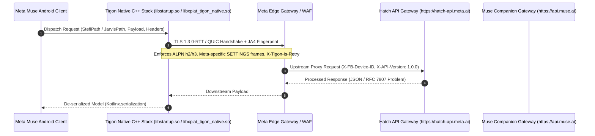

# Meta Muse v15: Centralized API Gateway & Transport Specification

## 1. Overview & Gateway Architecture

All communication between the Meta Muse Android client (`com.facebook.aura` v15.0.0.3.156, Version Code `1062001464`) and Meta backend services is routed through the centralized Hatch API Gateway and Muse Stefi transport subsystems:

- **Primary Gateway Base URL (Stefi):** `https://hatch-api.meta.ai` (`com.facebook.aura.mobileconfig.AuraMobileConfigFetcher.BASE_URL`, `com.facebook.aura.network.sandbox.AuraSandbox.STEFI_BASE_URL`)
- **Muse Companion Gateway Base URL:** `https://api.muse.ai` (`com.facebook.aura.network.sandbox.AuraSandbox.MUSE_STEFI_BASE_URL`)
- **Identity & Graph Base URL:** `https://graph.meta.com` (RSA Key Prefetch & Identity Assertion)
- **Dogfooding & Staging Sandbox Host:** `hatch-api.facebook.com` (`com.facebook.aura.network.transport.tigon.TigonHatchHttpClientKt.FACEBOOK_HATCH_HOST`, with dynamic `.od.facebook.com` sandbox resolution)
- **Protocol Stack:** Meta Tigon native C++ networking engine (`libxplat_tigon_native.so`, `libtrafficnts.so`, `libstartup.so`) over multiplexed HTTP/2 and HTTP/3 (QUIC), encapsulated within `TigonNoiseGatewayTransport` (`AuraNoiseVmTransport`) where hardware Confidential VM (CVM) routing is engaged.



---

## 2. Standard Transport & Identity Headers

Every request transmitted to `https://hatch-api.meta.ai` and `https://api.muse.ai` must supply a deterministic set of transport and fingerprint headers. Omission of these headers triggers immediate WAF filtering or automated bot detection flags.

| Header Name | Type / Format | Origin & Implementation Class | Description & Enforcement Rules |
| :--- | :--- | :--- | :--- |
| `Host` | String | Transport Layer | Evaluates to `hatch-api.meta.ai` or `api.muse.ai` (`hatch-api.facebook.com` in internal sandboxes). |
| `User-Agent` | String | `AuraUserAgent` | Production formatted string: `[FBAN/AuraForAndroid;FBAV/15.0.0.3.156;FBPN/com.facebook.aura;FBLC/en_US;FBBV/1062001464;FBCR/...;FBMF/...;FBBD/...;FBDV/...;FBSV/...;FBCA/...;FBDM/{...};]`. Fallback/simplified: `Aura/15.0.0.3.156 Android/14`. |
| `Authorization` | String | `AuraAuthHeaders` | `Bearer <token>`. Emits `currentMetaBearer()` (ABRA user token or anonymous token) for Meta Auth, or `currentVmBearer()` for VM JWT Bearer. |
| `X-API-Version` | String | `HatchAuthClient`, `AuraMobileConfigFetcher` | Constant `"1.0.0"`. Required on all native Hatch gateway requests. |
| `AuraDeviceId` / `X-FB-Device-ID` | UUIDv4 | `AuraDeviceIdProvider`, `AuraDeviceId` | Device identifier generated on first boot and stored in secure preferences (`BU5.A0U()`). Capitalized in auth payloads (`Locale.ROOT`), emitted as `X-FB-Device-ID` on Tigon wire. Example: `C92D3E1A-8B42-4A7B-901F-2B44671A39E1`. |
| `waterfall_id` | UUIDv4 (Lowercase) | `HatchAuthFlowContext` | End-to-end journey tracer. Generated via `UUID.randomUUID().toString()`, maintained across login, registration, and onboarding funnels. |
| `Content-Type` | String | Transport Layer | `application/json; charset=utf-8` (or `image/jpeg` for photo attachments). |
| `Accept` | String | `HatchAuthClient` | `application/json, application/problem+json`. |
| `X-FB-Connection-Type` | String | `libstartup.so` (Native Tigon) | Physical network radio state detected by native transport: `WIFI`, `MOBILE_LTE`, `MOBILE_5G`. |
| `X-Tigon-Is-Retry` | Boolean | `libstartup.so` (`onWillRetry`) | Emitted by Tigon native C++ transport when replaying a failed or interrupted connection (`false` on initial attempt). |
| `X-FB-Request-Analytics-Tags` | JSON String | `TigonHatchHttpClientKt` | Network telemetry tag: `{"network_tags":{"product":"4331325740476680"}}`. Injected on first-party OHAI secure requests. |
| `x-fb-e2e-proxy-to` | String | `TigonHatchHttpClient` | Target upstream hostname when executing end-to-end test proxying. |

---

## 3. RFC 7807 Standardized Problem+JSON Error Protocol

When an operation fails (e.g. invalid OTP, expired invite code, or geoblocked IP), the gateway emits an `application/problem+json` payload conforming to RFC 7807, de-serialized by `com.facebook.aura.json.HatchProblemJson`:

```json
{
  "type": "https://hatch-api.meta.ai/errors/invite-code-invalid",
  "title": "Invalid Invite Code",
  "status": 400,
  "detail": "The provided invite code does not exist or has expired.",
  "password_login_available": false,
  "auth_state": "st_auth_01h9e48f7a99b2401bcdae8901",
  "has_muse_account": false,
  "password_copy": null,
  "checkpoint_url": "",
  "error_code": "inviteCodeInvalid"
}
```

### 3.1 HatchProblemJson Formal Wire Model

Decompiled directly from `com.facebook.aura.json.HatchProblemJson` (`classes4.dex`):

| JSON Field | Type | Nullable | Description |
| :--- | :--- | :---: | :--- |
| `type` | String | No | Error classification URI or symbolic string (e.g. `invalidCode`, `inviteCodeInvalid`). |
| `title` | String | No | Human-readable error title. |
| `detail` | String | No | Detailed explanation of the failure reason. |
| `status` | Integer | No | Standard HTTP status code (e.g. `400`, `401`, `403`, `409`, `429`, `503`). |
| `password_login_available` | Boolean | No | Flags whether fallback password authentication is allowed for this account. |
| `auth_state` | String | No | Opaque backend session state handle to carry forward in subsequent requests. |
| `has_muse_account` | Boolean | Yes | Indicates whether the subject already has an active Muse companion profile. |
| `password_copy` | Object | Yes | UI copy block (`HatchPasswordCopyJson`) containing `title`, `body`, and button labels. |
| `checkpoint_url` | String | No | Web checkpoint challenge URL when interactive security verification is triggered. |
| `error_code` | String | No | Machine-readable error code enum identifier. |

---

### 3.2 Gateway Error Taxonomy & Handling Matrix

#### A. Authentication & Onboarding Errors (`com.facebook.aura.network.hatchauth.HatchAuthErrorKt`)

| HTTP Status | Error `type` / `error_code` | Description | Client Action |
| :---: | :--- | :--- | :--- |
| `400` | `invalidCode` | OTP verification code mismatch or corrupted code. | Re-prompt OTP entry (max 5 attempts). |
| `400` | `invalidPassword` | Supplied password does not match account credentials. | Prompt password re-entry or reset flow. |
| `400` | `completionHandleInvalid` | Registration completion handle expired or forged. | Restart onboarding registration from OTP step. |
| `400` | `linkHandleInvalid` | Account linking handle void or already claimed. | Re-initiate SSO linking flow. |
| `400` | `linkFailed` | Cross-app account linking rejected by identity provider. | Fallback to standalone credentials. |
| `400` | `contactPointRequiresPasswordLogin` | Contact point has password configured; OTP login disabled. | Switch UI to password entry mode. |
| `400` | `contactPointIsTwoFactorMethod` | Contact point is reserved as a 2FA destination. | Prompt primary credential first. |
| `400` | `twoFactorMethodUnsupported` | Selected 2FA challenge method unavailable on client. | Offer alternative 2FA challenge mechanism. |
| `400` | `passkeyAuthenticationFailed` | FIDO2/WebAuthn assertion signature rejected. | Offer fallback OTP / password entry. |
| `400` | `emailAlreadyInUse` | Email address belongs to an existing Meta account. | Prompt account sign-in or AYMH account selection. |
| `400` | `phoneAlreadyInUse` | Phone number already bound to an active identity. | Prompt account sign-in. |
| `400` | `underage` / `underageRegistration` | Date of birth does not satisfy legal age requirements. | Display regulatory compliance block screen. |
| `400` | `registrationBlocked` / `createBlocked` | Registration administratively prohibited for account/device. | Display support ticket contact form. |
| `400` | `registrationDisabled` | Global or regional new account creation disabled. | Direct user to waitlist. |
| `400` | `checkpointRequired` | Account flagged for suspicious activity; security checkpoint needed. | Open `checkpoint_url` in secure custom tab. |
| `400` | `tosContentVersionMismatch` | Client submitted agreement to outdated ToS version. | Fetch latest disclosure via `GET /hatch/tos_status`. |
| `401` | `sessionExpired` / `unauthorized` | ABRA bearer access token expired or invalidated. | Execute silent token rotation via `POST /hatch/refresh_access_token`. |
| `403` | `geoblocked` | Request originates from unauthorized geographic region. | Transition client to `ActivationState.GEO_BLOCKED`. |
| `429` | `rateLimited` / `maxAttemptsExceeded` | OTP dispatch or password rate limit exhausted. | Enforce client-side exponential backoff cooldown (15 min). |

#### B. Referral & Invite Code Errors (`com.facebook.aura.activation.repo.InviteCodeServerErrorKt`)

| HTTP Status | Error `type` | Normalized Result | Description |
| :---: | :--- | :--- | :--- |
| `400` | `inviteCodeInvalid` | `invalid_code` | Invite code does not exist in backend directory. |
| `400` | `inviteCodeRevoked` | `code_revoked` | Sponsor invite code revoked by Meta admin. |
| `400` | `inviteCodeUsedUp` | `code_used_up` | Invite code redemption quota (max 5) exhausted. |
| `400` | `inviteCodeWindowExpired` | `redemption_window_expired` | Redemption timeframe for invited batch has lapsed. |

#### C. Confidential VM (CVM) Enclave Lease Errors (`com.facebook.aura.gateway.HatchCvmColdLeaseException.Reason`)

| HTTP Status | Error `type` | Description | Client Action |
| :---: | :--- | :--- | :--- |
| `400` | `invalid_request` | Idempotency key malformed or missing parameters. | Re-generate UUIDv4 idempotency key. |
| `403` | `access_denied` | Account lacks entitlement for Confidential VM compute. | Direct user to subscription catalog. |
| `403` | `cold_lease_disabled` | Regional CVM cold lease feature flag turned off. | Prompt standard VM allocation. |
| `409` | `conflict` | Simultaneous lease provisioning race detected. | Retry cold lease with identical idempotency key. |
| `409` | `vm_limit` | User has already reached maximum provisioned VM limit. | Release idle VM via `/hatch/destroy_and_release_vm`. |
| `503` | `capacity_unavailable` | Hardware Confidential VM cluster saturated (enclave exhausted). | Fallback to `POST /hatch/start_svm_downgrade`. |

---

## 4. Sub-Document Reference

For the complete catalogue of verified endpoint URLs, query parameters, HTTP methods, and exact JSON wire schemas:
👉 [`ENDPOINTS_AND_SCHEMAS.md`](file:///home/ubuntu/projects/beta/api/ENDPOINTS_AND_SCHEMAS.md)
