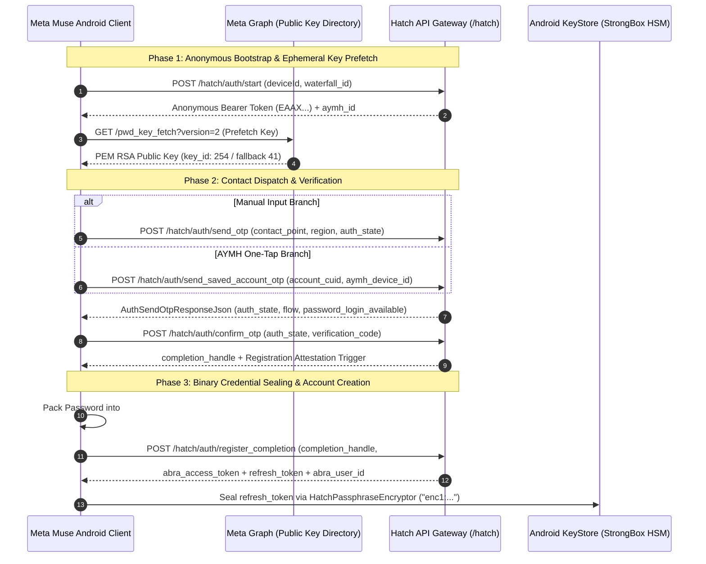

# Meta Muse v15: Authentication & Registration Lifecycle Architecture

## 1. Overview & Architectural Shift in v15

In Meta Muse v15 (`com.facebook.aura` v15.0.0.3.156, Version Code `1062001464`), the registration and authentication architecture has been completely decoupled from legacy single-shot credential submissions into a multi-phase asynchronous pipeline:

1. **Anonymous Pre-Authentication Handshake (`POST /hatch/auth/start`):** The client bootstraps an unauthenticated session, acquires an ephemeral anonymous bearer token (`EAAX...`), and initializes public key prefetch.
2. **Two-Branch Contact Point Verification:**
   - **Manual Branch (`POST /hatch/auth/send_otp`):** User inputs email or phone with client-side regex and regional validation.
   - **AYMH One-Tap Branch (`POST /hatch/auth/send_saved_account_otp`):** Zero-friction OTP dispatch using existing device accounts.
3. **OTP Confirmation & Registration Attestation (`POST /hatch/auth/confirm_otp`):** Validates the 6-digit verification code. If the user does not possess an active account, the endpoint returns an ephemeral cryptographic `completion_handle` and triggers hardware attestation via `HatchRegistrationAttestor`.
4. **Binary Envelope Sealing (`#PWD_ENC:2`):** Credentials are encrypted client-side using hybrid AES-256-GCM and RSAES-PKCS1-v1_5 bound to the current Unix epoch timestamp via Galois AEAD Additional Authenticated Data (AAD).
5. **Handle-Bound Credential Packaging (`POST /hatch/auth/register_completion`):** Plaintext credentials are never accepted. Registration requires the `completion_handle`, encrypted `#PWD_ENC:2` payload, and attestation tokens.
6. **Dual-Token Lifecycle & Hardware Isolation:** Issues short-lived `abra_access_token` and long-lived rotatable `refresh_token` sealed into Android KeyStore StrongBox HSM via `AuraMetaFRLSecureTokenStore`.



---

## 2. Decompiled Coroutine State Machine Audit (`HatchAuthApi.kt`)

Decompilation of `com.facebook.aura.login.nativeflow.HatchAuthApi` (compiled across `classes4.dex` and `classes6.dex`) reveals that each authentication phase is orchestrated through dedicated asynchronous Kotlin Coroutine continuations:

### 1. `HatchAuthApi$start$2`
- **Target Endpoint:** `StefiHatchPath$AuthStart` (`/hatch/auth/start`)
- **Request Payload:** `AuthStartRequestJson`
  ```json
  {
    "existing_id_for_aymh": null,
    "device_id": "3A8F...",
    "waterfall_id": "c71a..."
  }
  ```
- **Response Parsing:** Deserializes into `AuthStartResponseJson`, returning `HatchAuthStart(access_token, id_for_aymh)`.
- **Error Mapping:** Maps HTTP 4xx/5xx to `HatchAuthException` with `HatchProblemJson` RFC 7807 detail.

### 2. `HatchAuthApi$sendOtp$2`
- **Target Endpoint:** `StefiHatchPath$AuthSendOtp` (`/hatch/auth/send_otp`)
- **Authorization:** `Authorization: Bearer <anonymous_temp_token>`
- **Request Payload:** `AuthSendOtpRequestJson`
  ```json
  {
    "contact_point": "user@example.com",
    "region": "US",
    "prior_auth_state": null,
    "registration_source": "native_registration",
    "ntp_upsell": true,
    "device_id": "3A8F...",
    "waterfall_id": "c71a..."
  }
  ```
- **Response Parsing:** Returns `HatchAuthOtpSent` (`auth_state`, `password_login_available`, `flow`, `ntp_source_app`).

### 3. `HatchAuthApi$sendSavedAccountOtp$2`
- **Target Endpoint:** `StefiHatchPath$AuthSendSavedAccountOtp` (`/hatch/auth/send_saved_account_otp`)
- **Authorization:** `Authorization: Bearer <anonymous_temp_token>`
- **Request Payload:** `AuthSendSavedAccountOtpRequestJson`
  ```json
  {
    "account_cuid": "cuid_819203",
    "aymh_device_id": "device_aymh_12",
    "device_id": "3A8F...",
    "waterfall_id": "c71a..."
  }
  ```
- **Response Parsing:** Returns `HatchAuthOtpSent` with `HatchAuthFlow.Login`.

### 4. `HatchAuthApi$confirmOtp$2`
- **Target Endpoint:** `StefiHatchPath$AuthConfirmOtp` (`/hatch/auth/confirm_otp`)
- **Request Payload:** `AuthConfirmOtpRequestJson`
  ```json
  {
    "auth_state": "state_tok_9281...",
    "otp_code": "123456",
    "device_id": "3A8F...",
    "waterfall_id": "c71a..."
  }
  ```
- **Attestation Continuation:** If registration is required, suspends on `HatchAuthApiKt.beginRegistrationAttestation(...)` before yielding `completion_handle`.

### 5. `HatchAuthApi$registerCompletion$2`
- **Target Endpoint:** `StefiHatchPath$AuthRegisterCompletion` (`/hatch/auth/register_completion`)
- **Hardware Attestation:** Executes `HatchRegistrationAttestor.INSTANCE.attest(...)` if `HatchAttestationRequest` is present.
- **Request Payload:** `AuthRegisterCompletionRequestJson`
  ```json
  {
    "completion_handle": "handle_ephemeral_819...",
    "contact_point": "user@example.com",
    "region": "US",
    "date_of_birth": "2000-01-01",
    "first_name": "Aura",
    "last_name": "User",
    "password": "#PWD_ENC:2:1731146200:AQ...==",
    "tos_content_version": "v1.2",
    "device_id": "3A8F...",
    "waterfall_id": "c71a...",
    "attestation": { ... }
  }
  ```
- **Response Parsing:** Returns fully authenticated `HatchAuthCredentials` (`abra_access_token`, `refresh_token`, `abra_user_id`).

---

## 3. Security Threat Model & Funnel Invariants

1. **Galois AEAD Replay Mitigation:** Client embeds Unix epoch seconds into Galois Field AAD. Payloads older than 300 seconds are rejected by the Hatch API Gateway.
2. **Funnel Session Binding:** `waterfall_id` (UUIDv4) and uppercase `device_id` must maintain 100% consistency across all 5 coroutines. The gateway rejects downstream registrations missing valid start/OTP provenance.
3. **Brute Force Defense:** Incorrect OTP code submissions are throttled at 5 attempts before returning `HTTP 429 maxAttemptsExceeded` with a 15-minute lock.
4. **Hardware-Backed Credential Isolation:** Rotated refresh tokens are sealed using AES-256-GCM via `HatchPassphraseEncryptor` inside Android StrongBox HSM (`"hatch_meta_frl_token_store"`).

---

## 4. Specialized Deep-Dive Sub-Dossiers

For in-depth mathematical proofs, native JNI disassembly, and KeyStore lifecycle specifications, refer to:
- 🔐 [`PWD_ENC_CRYPTO.md`](file:///home/ubuntu/projects/beta/auth/PWD_ENC_CRYPTO.md) — Mathematical layout and JNI verification of the 7-element `#PWD_ENC:2` binary envelope.
- 🔄 [`TOKEN_LIFECYCLE.md`](file:///home/ubuntu/projects/beta/auth/TOKEN_LIFECYCLE.md) — Hardware KeyStore sealing, `AuraSessionManager`, and silent Tigon/Stefi replay loop.
