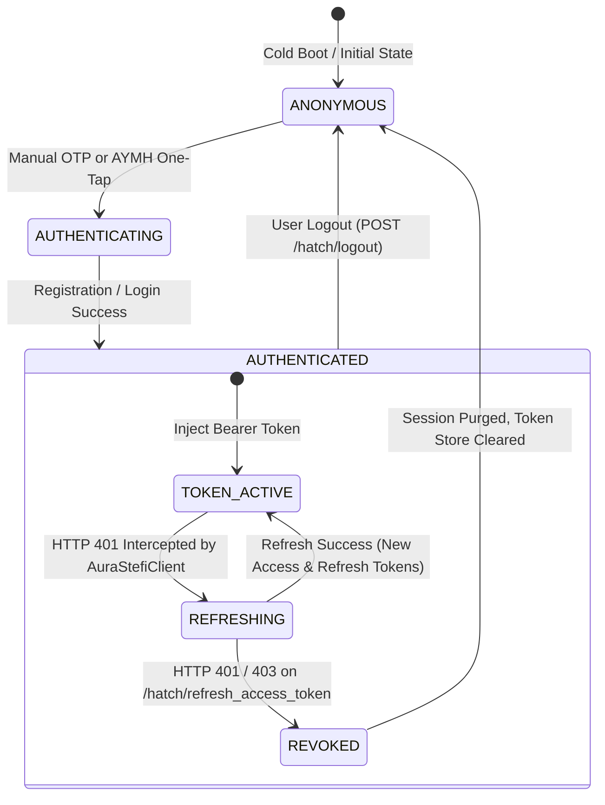
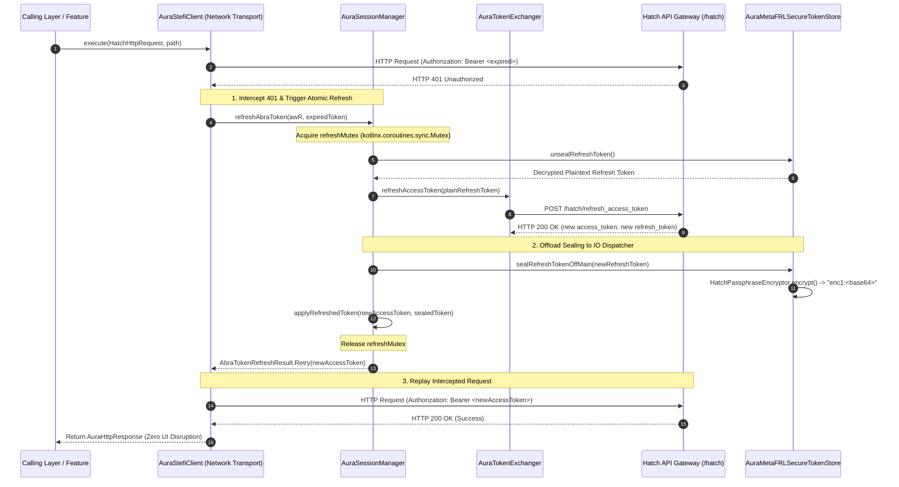

# Deep Dive Specification: Token Lifecycle, `AuraSessionManager` & KeyStore Hardware Sealing

## 1. Overview & Dual-Token Architecture

Meta Muse v15 (`com.facebook.aura` v15.0.0.3.156, Version Code `1062001464`) implements a zero-trust dual-token lifecycle architecture orchestrated by `com.facebook.aura.auth.AuraSessionManager` (decompiled from `classes4.dex`). Static long-lived API tokens are strictly eliminated.

1. **Short-Lived Bearer Token (`abra_access_token`):**
   - Cryptographically signed JWT-like bearer structure.
   - Lifetime: $\approx 3600\text{ seconds}$ (1 hour).
   - Injected on every outbound HTTP request in the `Authorization: Bearer <token>` header.
2. **Long-Lived Rotatable Refresh Token (`refresh_token`):**
   - High-entropy cryptographic opaque handle.
   - Lifetime: Up to 30 days.
   - Strictly confined to `POST /hatch/refresh_access_token`.
   - Rotated upon every successful redemption operation.



---

## 2. Hardware-Backed Storage: `AuraMetaFRLSecureTokenStore` & `HatchPassphraseEncryptor`

Bytecode analysis of `classes4.dex` reveals that tokens are never persisted in plaintext, nor do they rely on AndroidX `EncryptedSharedPreferences`. Instead, Meta uses a dedicated hardware-backed sealing engine composed of `AuraMetaFRLSecureTokenStore` and `HatchPassphraseEncryptor`.

### Key Storage Architecture
```
+-----------------------------------------------------------------------------------------+
|                               Android Application Sandbox                               |
|                                                                                         |
|  +---------------------------+              +----------------------------------------+  |
|  |    AuraSessionManager     |              |     AuraMetaFRLSecureTokenStore        |  |
|  |                           |              |                                        |  |
|  | - abra_access_token (RAM) |              | LightSharedPreferencesImpl (disk):     |  |
|  | - activeSessionGeneration |              |  - hatch_refresh_token: "enc1:<base64>"|  |
|  | - refreshMutex (4dI)      |              |  - meta_account_access_token: "enc1:." |  |
|  +-------------+-------------+              +-------------------+--------------------+  |
+----------------|------------------------------------------------|-----------------------+
                 | Offload Seal / Unseal                          |
                 v                                                v
+-----------------------------------------------------------------------------------------+
|                  HatchPassphraseEncryptor (AES/GCM/NoPadding, 256-bit)                  |
|                                                                                         |
|   Alias: "hatch_meta_frl_token_store"                                                   |
|   Envelope on Disk: "enc1:" || Base64(IV [12B] || Ciphertext [Var] || GHASH Tag [16B])  |
+-----------------------------------------------------------------------------------------+
                                          |
                                          v
+-----------------------------------------------------------------------------------------+
|                         AndroidKeyStore / Hardware Root of Trust                        |
|                                                                                         |
|   Master Key: KeyGenParameterSpec(alias, PURPOSE_ENCRYPT | PURPOSE_DECRYPT)              |
|   StrongBox HSM: setIsStrongBoxBacked(true) -> Fallback to TEE if unavailable           |
+-----------------------------------------------------------------------------------------+
```

### Cryptographic Primitive Specifications (`HatchPassphraseEncryptor.java`)
- **KeyStore Provider:** `"AndroidKeyStore"`
- **KeyStore Alias:** `"hatch_meta_frl_token_store"`
- **Key Generation:**
  ```java
  KeyGenerator keyGenerator = KeyGenerator.getInstance("AES", "AndroidKeyStore");
  keyGenerator.init(new KeyGenParameterSpec.Builder("hatch_meta_frl_token_store", 3) // 3 = ENCRYPT | DECRYPT
      .setBlockModes("GCM")
      .setEncryptionPaddings("NoPadding")
      .setKeySize(256)
      .setIsStrongBoxBacked(true) // Tries StrongBox HSM first
      .build());
  ```
- **StrongBox Fallback Mechanism:**
  ```java
  try {
      return generateKey(str, true); // Hardware StrongBox HSM
  } catch (StrongBoxUnavailableException unused) {
      return generateKey(str, false); // Standard Hardware TEE
  }
  ```
- **Disk Serialization Invariant:**
  - Encrypted payload prefix: `"enc1:"`
  - Body: `Base64.encodeToString(IV [12 bytes] || Ciphertext_with_Tag [Variable], Base64.NO_WRAP)`
  - Preference Keys stored in `com.facebook.crudolib.prefs.LightSharedPreferencesImpl`:
    - `hatch_refresh_token`
    - `meta_account_access_token`
    - `meta_account_id`
    - `meta_account_cookie`

---

## 3. Silent Token Renewal & Concurrency Control

When an access token expires during active user sessions, network requests are not terminated. Instead, the runtime transparently intercepts the 401 error, coordinates an atomic renewal, and replays pending mutations.



### Concurrency & Replay Queue Mechanics (`AuraSessionManager.java` & `AuraStefiClient.java`)

1. **Atomic Mutex Guard (`refreshMutex`):**
   - The token refresh block is guarded by `4dI` (`kotlinx.coroutines.sync.Mutex`).
   - Only the first coroutine that intercepts HTTP 401 executes the network refresh call.
   - Concurrent coroutines entering `refreshAbraToken` suspend on `refreshMutex.lock()`. Once the holder completes renewal, the suspended callers resume, observe that the active session generation has advanced, and return `AbraTokenRefreshResult.Retry(newAccessToken)` without issuing duplicate refresh calls.

2. **Result State Machine (`AbraTokenRefreshResult`):**
   - `AbraTokenRefreshResult.Retry(accessToken)`: Token renewed or already renewed by peer; caller replays request with `newAccessToken`.
   - `AbraTokenRefreshResult.Failed(accessToken)`: Gateway rejected refresh token with HTTP 401/403. Triggers immediate session revocation:
     ```java
     AuraLogoutHelper.INSTANCE.performLogoutIfCurrent(awR, failed.accessToken);
     AuraMetaFRLSecureTokenStore.INSTANCE.replaceSealedRefreshToken(null);
     ```
   - `AbraTokenRefreshResult.Unavailable`: Transient transport error (e.g. DNS failure, connection timeout); request fails without destroying local session.
   - `AbraTokenRefreshResult.SessionChanged`: User logged out or switched identity mid-flight; ongoing request is cleanly aborted.

3. **In-Flight Request Replay (`AuraStefiClient.execute`):**
   - When `AbraTokenRefreshResult.Retry` is received, `AuraStefiClient` calls:
     ```java
     hatchHttpClientHttpClient.executeWithBearer(hatchHttpRequest, newAccessToken, host, continuation);
     ```
   - This re-injects the fresh bearer token into the original request headers and resubmits to the gateway transparently.
