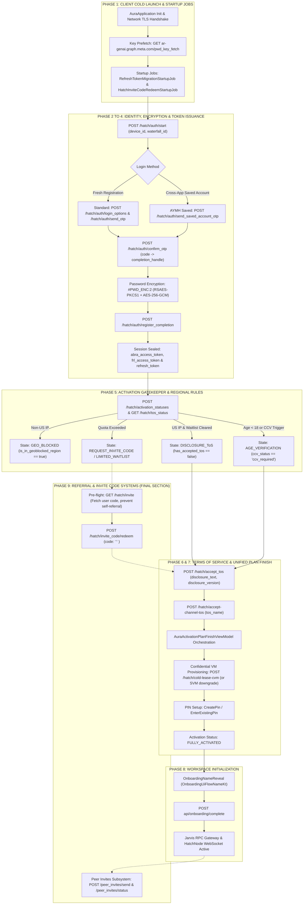
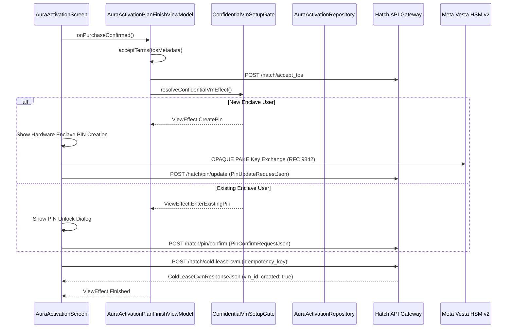
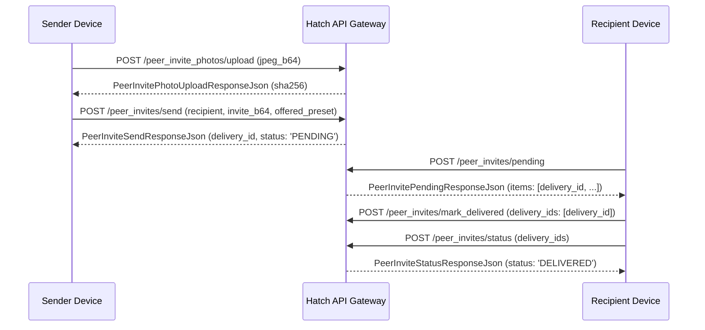

# Comprehensive Architecture Specification: Account Registration, Activation Gatekeeper & Onboarding Flow in Meta Muse v15.0.0.3.156

- **Target Binary Artifact:** `/workspace/muse-rea/binary/15.0.0.3.156.apk`
- **Package Identity:** `com.facebook.aura` (Internal Project Codename: *Project Aura* / *Hatch*)
- **Production Build Version:** `15.0.0.3.156` (Version Code `1062001464`, Build ID `1109388401`, VCS: `master:MASTER`)
- **Platform Targets:** `minSdkVersion: 29` (Android 10), `targetSdkVersion: 36` (Android 16), `compileSdkVersion: 37` (Android 17 preview)
- **Binary SHA-256 Digest:** `a099b8ec4aeda5bd9c4f2abfcb191388c3d300720691b1ed4b55b23c4a708cb5`
- **Analysis Engine:** Reverse Engineer Anything (REA 6.8.0) + JADX Headless MCP Engine + Native ELF Probes
- **File Location:** `/workspace/muse-rea/docs/ACCOUNT_REGISTRATION_AND_ONBOARDING_FLOW_V15.md`

---

## Table of Contents

1. [Executive Summary & Lifecycle Architecture](#1-executive-summary--lifecycle-architecture)
2. [Comparative Metric Analysis (v13 vs v14 vs v15)](#2-comparative-metric-analysis-v13-vs-v14-vs-v15)
3. [Transport, Headers & Post-Quantum Cryptography Architecture](#3-transport-headers--post-quantum-cryptography-architecture)
4. [Phase 1: Cold Launch, Startup Jobs & Cryptographic Key Prefetch](#4-phase-1-cold-launch-startup-jobs--cryptographic-key-prefetch)
5. [Phase 2: Contact Discovery, AYMH Saved Accounts & OTP Dispatch](#5-phase-2-contact-discovery-aymh-saved-accounts--otp-dispatch)
6. [Phase 3: Contact Point Verification (OTP Confirmation)](#6-phase-3-contact-point-verification-otp-confirmation)
7. [Phase 4: Credential Finalization & The New Refresh Token Architecture](#7-phase-4-credential-finalization--the-new-refresh-token-architecture)
8. [Phase 5: Activation Gatekeeper, Regional Rules & 18-State Machine](#8-phase-5-activation-gatekeeper-regional-rules--18-state-machine)
9. [Phase 6: Terms of Service, Multi-Channel Consent & Upsell Integration](#9-phase-6-terms-of-service-multi-channel-consent--upsell-integration)
10. [Phase 7: Unified Activation Plan & Confidential VM Enclave Provisioning](#10-phase-7-unified-activation-plan--confidential-vm-enclave-provisioning)
11. [Phase 8: Agentic Workspace Initialization & Onboarding Finalization](#11-phase-8-agentic-workspace-initialization--onboarding-finalization)
12. [Phase 9 (Final Module): Referral & Invite Code Redemption Systems](#12-phase-9-final-module-referral--invite-code-redemption-systems)
13. [Appendix: DEX Class Manifest & Wire Schema Reference](#13-appendix-dex-class-manifest--wire-schema-reference)

---

## 1. Executive Summary & Lifecycle Architecture

Meta Muse (`com.facebook.aura`, release `15.0.0.3.156`) is an autonomous, system-level conversational AI and personal compute assistant. The v15 release introduces several significant architectural shifts:

1. **Refresh Token Lifecycle:** Unlike v13 and v14 which relied solely on short-lived tokens without an integrated client renewal pipeline, v15 introduces an end-to-end token migration, silent renewal (`POST /hatch/refresh_access_token`), and server-side revocation (`POST /hatch/logout`) managed by `AuraSessionManager`.
2. **Post-Quantum Cryptography (PQ-KEM):** Inclusion of 27 compiled Rust libraries introducing NIST FIPS 203 ML-KEM-768, X-Wing hybrid KEM (X25519 + ML-KEM), OPAQUE asymmetric PAKE (RFC 9842), and Vesta HSM protocol v2.
3. **AYMH (Accounts You Might Have) Saved Account One-Tap OTP:** A streamlined authentication mechanism (`POST /hatch/auth/send_saved_account_otp`) leveraging cross-app Meta identity tokens (`account_cuid`, `aymh_device_id`).
4. **Unified Plan Finishing Orchestrator:** Introduction of `AuraActivationPlanFinishViewModel`, coordinating subscription verification, Terms of Service agreements, and Confidential VM hardware PIN enrollment in a single pipeline.
5. **Dual-Tier Referral & Pairing Architecture:** Retention of the core server-side waitlist referral engine (`POST /hatch/invite_code/redeem`), coupled with a brand new decentralized Peer Invites subsystem (`com.facebook.aura.pairs.PeerInvitesPath`) supporting media attachments and encrypted delivery.



---

## 2. Comparative Metric Analysis (v13 vs v14 vs v15)

| Dimension / Metric | Release v13.0.0.4.159 | Release v14.0.0.4.149 | Release v15.0.0.3.156 | Net Delta (v15 vs v14) |
| :--- | :--- | :--- | :--- | :--- |
| **Version Code** | `1061801514` | `1061901406` | `1062001464` | `+99,998` |
| **APK Binary Size** | 42.47 MB | 43.84 MB | 45.82 MB | `+1.98 MB` |
| **DEX Classes (JADX)** | 39,824 | 41,660 | 44,230 | `+2,570` |
| **StefiHatchPath Endpoints** | 86 (v11 base) | 105 | 113 | `+8` |
| **JarvisPath Endpoints** | 142 | 181 | 187 | `+6` |
| **PeerInvitesPath Endpoints** | None (0) | None (0) | 7 | `+7 (New Enum)` |
| **Native Libraries (.so)** | 35 | 35 | 62 | `+27 (Rust PQ)` |
| **Manifest Components** | 80 | 82 | 97 | `+15` |
| **Token Session Model** | Single-hop token | Single-hop token | Refresh Token Loop | Integrated refresh |
| **Target / Compile SDK** | 36 / 36 | 36 / 36 | 36 / 37 | SDK 37 support |

---

## 3. Transport, Headers & Post-Quantum Cryptography Architecture

### Transport Layer
Requests are transmitted via **Meta Tigon** multiplexed over HTTP/2 and HTTP/3 (QUIC) to `https://hatch-api.meta.ai`. In v15, Tigon is paired with an application-layer Noise Protocol engine (`TigonNoiseGatewayTransport`) for end-to-end encrypted tunnels.

### Required HTTP Headers
```http
Host: hatch-api.meta.ai
Accept: application/json
Content-Type: application/json; charset=utf-8
X-API-Version: 1.0.0
X-FB-Trace-Id: <UUIDv4>
X-FB-Request-Id: <16-Character Hex Lowercase>
Authorization: Bearer <access_token>
User-Agent: [FBAN/AuraAndroid;FBAV/15.0.0.3.156;FBBV/1062001464;FBDV/Pixel 8;FBMF/Google;FBSV/14;FBLC/en_US;FBDM/{density=2.625,width=1080,height=2400}]
```

### Post-Quantum Cryptographic Libraries (arm64-v8a)
The `lib/arm64-v8a/` directory in v15 integrates 27 dedicated Rust native libraries providing post-quantum and advanced zero-knowledge primitives:
- `libthird-party_rust_vendor_ml-kem_0.3.so`: NIST FIPS 203 ML-KEM (Kyber) post-quantum key encapsulation.
- `libthird-party_rust_vendor_x-wing_0.1.so`: Hybrid post-quantum key exchange combining classical X25519 with ML-KEM-768.
- `libthird-party_rust_vendor_opaque-ke_4.so`: OPAQUE asymmetric PAKE protocol (RFC 9842).
- `libthird-party_rust_vendor_voprf_0.5.so`: Verifiable Oblivious Pseudorandom Functions (RFC 9497).
- `libthird-party_rust_vendor_hpke_0.13.so`: Hybrid Public Key Encryption (RFC 9180).
- `libxplat_rust_vesta_client_v2_proto_vesta_proto-rustAndroid.so`: Meta Vesta HSM v2 protocol bridge.

---

## 4. Phase 1: Cold Launch, Startup Jobs & Cryptographic Key Prefetch

### Application Bootstrap
Upon invocation of `com.facebook.aura.app.AuraApplication`, `AppJobScheduler` initializes the sessioned startup pipeline. Two critical startup jobs govern onboarding and credential health:

1. **`RefreshTokenMigrationStartupJob` (`com.facebook.aura.startup.login`):**
   - Checks if the user session has an existing legacy Meta access token without a refresh token.
   - Invokes `AuraSessionManager.migrateToRefreshToken(awR)`.
   - Exchanges token via `AuraTokenExchanger.exchangeForProfileToken` and seals the resulting refresh token off-main (`sealRefreshTokenOffMain`).
2. **`HatchInviteCodeRedeemStartupJob` (`com.facebook.aura.startup.onboarding`):**
   - Evaluates `HatchDeferredInviteCodeStore` for any referral token captured from Google Play Install Referrer (`captureFromReferrer`) or AppManager metadata (`captureFromAppManagerCustomData`) within its 7-day TTL (`604,800,000` ms).
   - If MobileConfig `MC.hatch_gtm.app_install_silent_redeem_code` is true and the user is not yet `FULLY_ACTIVATED`, it silently invokes `AuraActivationRepository.redeemInviteCode(code, true, true)`.
   - If redemption fails and the account is partially registered, it calls `releaseToManualEntry()` to display the manual entry screen.

### Public Key Fetch for Password Encryption
Before transmitting plaintext user credentials, the client fetches the RSA public key:
- **Endpoint:** `GET https://ar-genai.graph.meta.com/pwd_key_fetch`
- **Fallback Host:** `https://api.facebook.com/method/pwd_key_fetch`
- **Response Format:**
```json
{
  "public_key": "-----BEGIN PUBLIC KEY-----\nMIIBIjANBgkqhkiG9w0BAQEFAAOCAQ8AMIIBCgKCAQEA...\n-----END PUBLIC KEY-----",
  "key_id": "78"
}
```

---

## 5. Phase 2: Contact Discovery, AYMH Saved Accounts & OTP Dispatch

### 2.1 Unauthenticated Session Bootstrap
The client establishes an initial tracking session with the Hatch authentication gateway:
- **Endpoint:** `POST https://hatch-api.meta.ai/hatch/auth/start`
- **Class Identifier:** `com.facebook.aura.network.api.StefiHatchPath.AuthStart`
- **Request Payload (`AuthStartRequestJson`):**
```json
{
  "device_id": "4b68e982-1200-4b8c-8f19-a92c0199e120",
  "id_for_aymh": "aymh_sub_01h9e48271",
  "waterfall_id": "8f3b2a19-c09e-4a6b-bc54-20d091e77f01"
}
```
- **Response Payload (`AuthStartResponseJson`):**
```json
{
  "access_token": "EAAX...temporay_auth_start_bearer...",
  "id_for_aymh": "aymh_sub_01h9e48271"
}
```
The returned `access_token` is injected into the `Authorization: Bearer` header for all subsequent unauthenticated registration calls.

### 2.2 Branch A: Standard Contact Point OTP Dispatch
For fresh registrations without existing local device profiles:
- **Discovery:** `POST https://hatch-api.meta.ai/hatch/auth/login_options` (`device_id`, `waterfall_id`).
- **OTP Dispatch:** `POST https://hatch-api.meta.ai/hatch/auth/send_otp`
  - **Payload:** `{"contact_point": "user@example.com", "region": "US"}`

### 2.3 Branch B: AYMH (Accounts You Might Have) Saved Account One-Tap OTP (New in v15)
When the app detects saved accounts from the Meta family (`com.facebook.katana`, `com.instagram.android`, WhatsApp):
- **Endpoint:** `POST https://hatch-api.meta.ai/hatch/auth/send_saved_account_otp`
- **Class Identifier:** `com.facebook.aura.network.api.StefiHatchPath.AuthSendSavedAccountOtp`
- **Request Payload (`AuthSendSavedAccountOtpRequestJson`):**
```json
{
  "account_cuid": "cuid_9812491024",
  "aymh_device_id": "aymh_dev_77a98c01",
  "device_id": "4b68e982-1200-4b8c-8f19-a92c0199e120",
  "waterfall_id": "8f3b2a19-c09e-4a6b-bc54-20d091e77f01"
}
```

---

## 6. Phase 3: Contact Point Verification (OTP Confirmation)

The user inputs the 6-digit verification code dispatched via email or SMS.
- **Endpoint:** `POST https://hatch-api.meta.ai/hatch/auth/confirm_otp`
- **Class Identifier:** `com.facebook.aura.network.api.StefiHatchPath.AuthConfirmOtp`
- **Request Payload (`AuthConfirmOtpRequestJson`):**
```json
{
  "contact_point": "user@example.com",
  "code": "849201",
  "waterfall_id": "8f3b2a19-c09e-4a6b-bc54-20d091e77f01"
}
```
- **Response Payload (`AuthConfirmOtpResponseJson`):**
```json
{
  "completion_handle": "handle_comp_01h9e48f7a99b2401bcdae8901",
  "is_existing_account": false
}
```
The `completion_handle` binds the verified contact point cryptographically to the profile finalization phase.

---

## 7. Phase 4: Credential Finalization & The New Refresh Token Architecture

### 7.1 Binary Credential Packaging (`#PWD_ENC:2`)
Passwords are never transmitted in plaintext. The mobile client encapsulates the password into the `#PWD_ENC:2` binary envelope:
1. Generate an ephemeral 32-byte AES key ($K$) and 12-byte initialization vector ($IV$).
2. Encrypt the plaintext UTF-8 password using `AES-256-GCM` with $K$, $IV$, and the current Unix epoch timestamp as Additional Authenticated Data (AAD).
3. The AES-GCM output generates a 16-byte authentication tag ($T$) followed by the ciphertext ($C$).
4. Encrypt $K$ using the Meta RSA public key (`RSAES-PKCS1-v1_5`).
5. Serialize the binary package:
   `[1 byte: key_id_len] [key_id bytes] [2 bytes: rsa_len] [RSA(K)] [12 bytes: IV] [16 bytes: Tag] [Ciphertext]`
6. Encode to Base64 and prefix: `#PWD_ENC:2:<timestamp>:<base64_payload>`.

### 7.2 Registration Completion Call
- **Endpoint:** `POST https://hatch-api.meta.ai/hatch/auth/register_completion`
- **Class Identifier:** `com.facebook.aura.network.api.StefiHatchPath.AuthRegisterCompletion`
- **Request Payload (`AuthRegisterCompletionRequestJson`):**
```json
{
  "completion_handle": "handle_comp_01h9e48f7a99b2401bcdae8901",
  "first_name": "Aura",
  "last_name": "User",
  "date_of_birth": "1998-05-14",
  "password": "#PWD_ENC:2:1794011607:Ac4F...encrypted_blob...",
  "region": "US",
  "device_id": "4b68e982-1200-4b8c-8f19-a92c0199e120",
  "waterfall_id": "8f3b2a19-c09e-4a6b-bc54-20d091e77f01",
  "tos_content_version": "v1.0",
  "attestation": {
    "proof": "eyJhbGciOiJSUzI1NiJ9...",
    "evidence": "basic_integrity_pass",
    "errors": []
  }
}
```
- **Response Payload (`AuthRegisterCompletionResponseJson`):**
```json
{
  "abra_access_token": "EAAX...abra_bearer_token...",
  "abra_user_id": "100084920194821",
  "frl_access_token": "FRL...identity_token...",
  "frl_account_id": "frl_acc_01h9e48",
  "refresh_token": "rft_01h9e48_9a7bc091e48f8a123bc"
}
```

### 7.3 Token Lifecycle Management in v15
Upon receiving the tokens:
1. `AuraSessionManager.INSTANCE.applyRefreshedToken()` seals `refresh_token` into Android Keystore via `sealRefreshTokenOffMain()`.
2. `abra_access_token` is designated as the primary bearer credential for all subsequent API calls.
3. **Transparent Token Rotation:** If any call returns HTTP 401 Unauthorized, `AuraSessionManager.redeemRefreshToken()` triggers:
   - **Endpoint:** `POST https://hatch-api.meta.ai/hatch/refresh_access_token` (`StefiHatchPath.RefreshAccessToken`)
   - **Payload (`RefreshAccessTokenRequestJson`):** `{"refresh_token": "rft_..."}`
   - **Response (`RefreshAccessTokenResponseJson`):** `{"access_token": "...", "refresh_token": "..."}`
4. **Logout Revocation:** User logout invokes `AuraServerLogout.submit()`:
   - **Endpoint:** `POST https://hatch-api.meta.ai/hatch/logout` (`StefiHatchPath.Logout`)
   - **Payload (`LogoutRequestJson`):** `{"refresh_token": "rft_..."}`

---

## 8. Phase 5: Activation Gatekeeper, Regional Rules & 18-State Machine

Following authentication, the client polls the gatekeeper endpoints:
- `POST https://hatch-api.meta.ai/hatch/activation_statuses?supported_retos_presentations[0]=bottom_sheet` (`StefiHatchPath.ActivationStatuses`)
- `GET https://hatch-api.meta.ai/hatch/tos_status` (`StefiHatchPath.TosStatus`)

### Complete Wire Schema: `ActivationStatusesResponseJson`
Decompiled from `com.facebook.aura.user.repo.ActivationStatusesResponseJson`:
```json
{
  "has_hatch_access": true,
  "has_completed_hatch_activation": false,
  "has_cleared_acquisition": true,
  "has_provisioned_vm": false,
  "has_redeemed_invite_code": false,
  "is_in_geoblocked_region": false,
  "is_nda_required": false,
  "ccv_status": "not_required",
  "requires_name": false,
  "name_prefill": "Aura User",
  "name_dialog": null,
  "email_address_prefill": "user@example.com",
  "is_vm_type_selection_required": true,
  "is_vm_type_plan_required": false,
  "hatch_wearables_linked": false,
  "hatch_wearables_comms_consent": null,
  "invite_code_entry_available": true,
  "enter_invite_code_screen": null,
  "waitlist_available": false,
  "waitlist_status": "OFF_WAITLIST",
  "waitlist_choice_screen": null,
  "waitlisted_screen": null,
  "waitlisted_limited_screen": null,
  "retos": null
}
```

### Complete Wire Schema: `TosStatusResponseJson`
Decompiled from `com.facebook.aura.activation.repo.TosStatusResponseJson`:
```json
{
  "has_accepted_tos": false,
  "disclosure_title": "Meta Muse Terms of Service",
  "disclosure_text": "Meta Muse Terms of Service and Privacy Policy...",
  "disclosure_version": "2026.11.01",
  "disclosure_button_text": "Agree and Continue",
  "disclosure_entities": [],
  "disclosure_sections": [],
  "cvm_upsell_cell": null,
  "subscription_disclosure_text": null,
  "subscription_disclosure_entities": [],
  "subscription_upsell_cell": null
}
```

### State Machine Definition (`com.facebook.aura.activation.data.ActivationState`)
The client-side activation engine evaluates the response into one of 18 explicit states via `ActivationState.Companion.getCurrentActivationState()` in strict priority order:

1. `LOADING`: Cold startup state awaiting gateway payload.
2. `RETOS`: `retos != null` or `has_pending_retos == true`. Updated Terms of Service re-consent required.
3. `LIMITED_WAITLIST`: Regional capacity throttled; restricted access tier (`69d.A04`).
4. `ALREADY_WAITLISTED`: User has previously joined waitlist queue (`69d.A06`).
5. `REQUEST_WAITLIST`: Region unsupported for auto-admission; user offered waitlist join via `POST /hatch/waitlist/join`.
6. `REQUEST_INVITE_CODE`: Admission gated strictly by invite code redemption.
7. `GEO_BLOCKED`: `is_in_geoblocked_region == true`. User IP is outside authorized territories.
8. `NO_ACCESS`: System-level restriction or entitlement revocation (`has_hatch_access == false`).
9. `NDA`: `is_nda_required == true`. Meta confidential non-disclosure agreement pending signature.
10. `BLOCKED`: Account flagged or suspended for policy non-compliance (`ccv_status == "blocked"`).
11. `AGE_VERIFICATION`: `ccv_status == "ccv_required"`. Cross-Channel WebAuth verification required via Instagram/Facebook.
12. `DISCLOSURE_ToS`: `has_accepted_tos == false`. Terms of Service disclosure pending acceptance.
13. `WEARABLES_LINKING`: `hatch_wearables_linked == false` and linking required. Smart glasses pairing flow active.
14. `NAME_REQUIRED`: `requires_name == true`. Profile name missing; resolved via `POST /hatch/viewer/name`.
15. `CONFIDENTIAL_VM_SETUP`: `is_vm_type_selection_required == true` and PIN enrollment uncompleted.
16. `FULLY_ACTIVATED`: All gatekeepers passed (`has_completed_hatch_activation == true`); conversational workspace unlocked.
17. `VM_PROVISIONING`: Hardware enclave allocation actively executing in Meta infrastructure (`has_hatch_access == true`).

### Specialized Gatekeeper Mutation Endpoints:
- **Set Viewer Profile Name (`NAME_REQUIRED`):**
  - **Endpoint:** `POST https://hatch-api.meta.ai/hatch/viewer/name`
  - **Class Identifier:** `com.facebook.aura.network.api.StefiHatchPath.SetViewerName`
  - **Payload:** `{"name": "Aura Explorer"}`
- **Join Waitlist (`REQUEST_WAITLIST`):**
  - **Endpoint:** `POST https://hatch-api.meta.ai/hatch/waitlist/join`
  - **Class Identifier:** `com.facebook.aura.network.api.StefiHatchPath.WaitlistJoin`
  - **Payload (`JoinWaitlistRequestJson`):** `{"region": "US"}`
- **Wearables Linking & Consent (`WEARABLES_LINKING`):**
  - `POST https://hatch-api.meta.ai/hatch/wearables/link` (`StefiHatchPath.WearablesLink`)
  - `POST https://hatch-api.meta.ai/hatch/wearables/comms_consent` (`StefiHatchPath.WearablesCommsConsent`)
  - `POST https://hatch-api.meta.ai/hatch/wearables/complimentary_offer` (`StefiHatchPath.WearablesComplimentaryOffer`)

### Regional Bypass Rules
When requests originate from a verified US residential/mobile IP:
- `is_in_geoblocked_region`: `false`
- `waitlist_available`: `false`
- `has_cleared_acquisition`: `true`
- The state transitions directly to `DISCLOSURE_ToS` without waitlist interception.

---

## 9. Phase 6: Terms of Service, Multi-Channel Consent & Upsell Integration

In release v15, the Terms of Service presentation is unified through `AuraDisclosureViewModel` and incorporates subscription upselling directly into the legal disclosure screen (`HatchTosMetadata`):
- `subscriptionDisclosure`: `HatchDisclosureText`
- `subscriptionUpsellCell`: `HatchUpsellCell`

### 6.1 Terms Acceptance Call
- **Endpoint:** `POST https://hatch-api.meta.ai/hatch/accept_tos`
- **Class Identifier:** `com.facebook.aura.network.api.StefiHatchPath.AcceptTos`
- **Request Payload (`AcceptTosRequestJson`):**
```json
{
  "disclosure_text": "Meta Muse Terms of Service and Privacy Policy...",
  "disclosure_version": "2026.11.01",
  "retos_content_version": "v1.0"
}
```

### 6.2 Channel-Bound Consent Call
- **Endpoint:** `POST https://hatch-api.meta.ai/hatch/accept-channel-tos`
- **Class Identifier:** `com.facebook.aura.network.api.StefiHatchPath.AcceptChannelTos`
- **Request Payload (`AcceptChannelTosRequestJson`):**
```json
{
  "tos_name": "channel_agent_tos_v1"
}
```

### 6.3 Dynamic NDA Agreement Acceptance (If Flagged)
If `is_nda_required == true`, the client queries `AuraActivationRepository.fetchNdaAgreement()` and accepts:
- **Fetch NDA Agreement:**
  - **Endpoint:** `GET https://hatch-api.meta.ai/hatch/agreements/{agreement_id}`
  - **Class Identifier:** `com.facebook.aura.network.api.StefiHatchPath.OneClickAgreement`
  - **Response Payload (`NdaAgreementResponseJson`):**
```json
{
  "agreement_id": "agr_nda_01h9e48f",
  "title": "Meta Confidential Non-Disclosure Agreement",
  "terms": [
    {
      "term_id": "term_confidentiality",
      "text": "User agrees not to disclose unannounced features..."
    }
  ],
  "version": "2026.11"
}
```
- **Accept NDA Agreement:**
  - **Endpoint:** `POST https://hatch-api.meta.ai/hatch/agreements/{agreement_id}/accept`
  - **Class Identifier:** `com.facebook.aura.network.api.StefiHatchPath.OneClickAgreementAccept`
  - **Request Payload (`NdaAcceptRequestJson`):**
```json
{
  "disclosure_text": "Meta Confidential Non-Disclosure Agreement...",
  "disclosure_version": "2026.11"
}
```
  - **Response Payload (`NdaAcceptResponseJson`):**
```json
{
  "accepted": true
}
```

---

## 10. Phase 7: Unified Activation Plan & Confidential VM Enclave Provisioning

Release v15 replaces fragmented provisioning steps with the `AuraActivationPlanFinishViewModel` orchestrator:



### Hardware Cold Lease Execution
- **Endpoint:** `POST https://hatch-api.meta.ai/hatch/cold-lease-cvm`
- **Class Identifier:** `com.facebook.aura.network.api.StefiHatchPath.ColdLeaseCvm`
- **Request Payload (`ColdLeaseCvmRequestJson`):**
```json
{
  "idempotency_key": "4b68e982-1200-4b8c-8f19-a92c0199e120"
}
```
- **Response Payload (`ColdLeaseCvmResponseJson`):**
```json
{
  "vm_id": "cvm_us_east_4b9a8201",
  "created": true
}
```

### Hardware Security Module: Meta Vesta v2 & PIN Cryptography
Confidential VM credentials and escrow state are protected via Meta Vesta HSM v2 (`libxplat_rust_vesta_client_v2_proto_vesta_proto-rustAndroid.so`):
- **Vesta User Info Query:**
  - **Endpoint:** `GET https://hatch-api.meta.ai/hatch/vesta/user_info`
  - **Class Identifier:** `com.facebook.aura.network.api.StefiHatchPath.VestaUserInfo`
  - **Response (`ConfidentialVmVestaUserInfoResponseJson`):**
```json
{
  "has_vesta_account": true,
  "vesta_user_id": "vusr_01h9e48f7a99b2401bcdae8901",
  "enrolled_pin_revision": 1
}
```
- **Enclave PIN Creation / Update (`PinUpdateRequestJson`):**
```json
{
  "encrypted_pin_verifier": "opaque_v2_pake_verifier_base64...",
  "last_successful_entry_at_ms": 1794011607000,
  "update_id": "upd_01h9e48f",
  "replaces_update_id": null
}
```
- **Enclave PIN Confirmation (`PinConfirmRequestJson`):**
```json
{
  "reminder_id": "rem_01h9e48",
  "update_id": "upd_01h9e48f",
  "state_revision": 1,
  "last_successful_entry_at_ms": 1794011607000,
  "had_wrong_guess": false
}
```

### Standard VM (SVM) Downgrade Pipeline
If hardware enclave capacity is constrained or the user rejects CVM terms, the client can fall back:
- **Endpoint:** `POST https://hatch-api.meta.ai/hatch/start_svm_downgrade` (`StefiHatchPath.StartSvmDowngrade`)

---

## 11. Phase 8: Agentic Workspace Initialization & Onboarding Finalization

### 8.1 Elimination of Legacy Greeting Screen
In v15, `OnboardingUiFlowGreetingKt` has been removed and replaced by `OnboardingNameReveal` and `OnboardingUiFlowNameKt`, which handles animated identity revealing and user profile configuration.

### 8.2 Onboarding Completion Call
- **Endpoint:** `POST https://hatch-api.meta.ai/api/onboarding/complete`
- **Class Identifier:** `com.facebook.aura.network.api.JarvisPath.OnboardingComplete`
- **Request Payload (`OnboardingCompleteRequestJson`):**
```json
{
  "completed_screens": ["name_reveal", "avatar_select", "disclosure_tos"],
  "selected_preset": "assistant_general"
}
```
- **Result:** The user status updates to `ActivationState.FULLY_ACTIVATED`. The full Jarvis conversational router, web browser UniFFI engine, and device node RPC system become available.

---

## 12. Phase 9 (Final Module): Referral & Invite Code Redemption Systems

*(Per monorepo engineering standards, invite and referral code redemption specifications reside exclusively at the final section of all architectural documents).*

Meta Muse v15 operates a dual-tier referral model:
1. **Tier A (Server-Side Growth & Waitlist Redemption):** The classic code-based redemption engine used to bypass waitlists or claim compute credits.
2. **Tier B (Peer Invites Subsystem):** A newly added decentralized pairing system under `com.facebook.aura.pairs.PeerInvitesPath`.

---

### 12.1 Tier A: Server-Side Growth & Waitlist Redemption

#### Step 1: Pre-Flight Handshake (`GET /hatch/invite`)
Before executing any redemption mutation, the client's `HatchRedeemInviteCodeViewModel` invokes `loadInvitePage()`. Omitting this pre-flight query causes backend anti-fraud state machines to emit ambiguous `invalid_code` errors:
- **Endpoint:** `GET https://hatch-api.meta.ai/hatch/invite`
- **Class Identifier:** `com.facebook.aura.network.api.StefiHatchPath.Invite`
- **Response Payload (`InvitePageResponseJson`):**
```json
{
  "code": "MUSE-ALPHA-9821",
  "has_redeemed_invite_code": false,
  "invite_link": "https://agent.meta.ai/invite?code=MUSE-ALPHA-9821",
  "invite_state": "ACTIVE",
  "uses_remaining": 5,
  "show_redeem_button": true,
  "shows_gift": true,
  "title": "Claim Compute Credits",
  "subtitle": "Redeem an invite code to activate access.",
  "redeem_invite_code_screen": {
    "title": "Enter Invite Code",
    "description": "Enter the 16-character code provided by your sponsor."
  },
  "reward": {
    "reward_type": "CVM_HOURS",
    "amount": 50
  }
}
```

#### Step 2: Self-Referral Collision Guard
The client compares the entered code against `InvitePageResponseJson.code`. If identical, the operation is blocked client-side to prevent redundant state corruption.

#### Step 3: Input Normalization
Input text is trimmed of whitespace and uppercase-normalized:
`code.trim().toUpperCase(Locale.ROOT)`.

#### Step 4: Redemption Mutation (`POST /hatch/invite_code/redeem`)
- **Endpoint:** `POST https://hatch-api.meta.ai/hatch/invite_code/redeem`
- **Class Identifier:** `com.facebook.aura.network.api.StefiHatchPath.InviteCodeRedeem`
- **Request Payload (`RedeemInviteCodeRequestJson`):**
```json
{
  "code": "MUSE-ALPHA-8492"
}
```
- **Response Payload (`RedeemInviteCodeResponseJson`):**
```json
{
  "waitlist_status": "OFF_WAITLIST"
}
```

#### Step 5: Deferred Silent Redemption Lifecycle
- `HatchDeferredInviteCodeStore` captures referral strings (`invite_code`) via Google Play Install Referrer or Facebook AppManager.
- `HatchInviteCodeRedeemStartupJob` automatically executes `redeemInviteCode(code, updateLocalState = true, retryable = true)` during app startup if the account is not yet `FULLY_ACTIVATED`.

#### RFC 7807 Standard Error Responses
When redemption fails, the server emits `application/problem+json`:
```json
{
  "type": "https://hatch-api.meta.ai/errors/invite-code-invalid",
  "title": "Invalid Invite Code",
  "status": 400,
  "detail": "The provided invite code does not exist or has expired.",
  "code": "inviteCodeInvalid"
}
```
- `inviteCodeInvalid`: Code does not exist in registry.
- `inviteCodeUsedUp`: Redemption quota exhausted.
- `inviteCodeRevoked`: Administrator revocation.

#### Step 6: Sponsor Invite Code Generation (`POST /hatch/invite_code/generate`)
Active users who have cleared onboarding can generate their own sponsor invite codes to distribute to peers:
- **Endpoint:** `POST https://hatch-api.meta.ai/hatch/invite_code/generate`
- **Class Identifier:** `com.facebook.aura.network.api.StefiHatchPath.InviteCodeGenerate`
- **Response Payload (`GenerateInviteCodeResponseJson`):**
```json
{
  "code": "MUSE-ALPHA-9821",
  "invite_link": "https://agent.meta.ai/invite?code=MUSE-ALPHA-9821",
  "max_uses": 5,
  "use_count": 0,
  "share_text": "Join me on Meta Muse using my VIP invite code: MUSE-ALPHA-9821"
}
```

#### Debug Reset Endpoints (Meta Internal Dogfooding Builds)
- **Reset Invite Code Redemption:**
  - **Endpoint:** `POST https://hatch-api.meta.ai/hatch/debug/reset_invite_code_redemption`
  - **Class Identifier:** `com.facebook.aura.network.api.StefiHatchPath.DebugResetInviteCodeRedemption`
  - **Response (`DebugResetInviteCodeRedemptionResponseJson`):** `{"success": true}`
- **Reset Complete Activation State:**
  - **Endpoint:** `POST https://hatch-api.meta.ai/hatch/debug/reset_activation`
  - **Class Identifier:** `com.facebook.aura.network.api.StefiHatchPath.DebugResetActivation`
  - **Response (`DebugResetActivationResponseJson`):** `{"success": true}`

---

### 12.2 Tier B: The New Peer Invites Subsystem (`com.facebook.aura.pairs`)

Introduced in v15, the Peer Invites system allows direct user-to-user pairing with media exchange:



#### 1. Photo Attachment Upload
- **Endpoint:** `POST https://hatch-api.meta.ai/peer_invite_photos/upload`
- **Enum Entry:** `PeerInvitesPath.PhotoUpload`
- **Request Payload (`PeerInvitePhotoUploadJson`):**
```json
{
  "jpeg_b64": "/9j/4AAQSkZJRgABAQEASABIAAD...",
  "expires_at": 1794616407000
}
```
- **Response Payload (`PeerInvitePhotoUploadResponseJson`):**
```json
{
  "sha256": "4b68e98212004b8c8f19a92c0199e1208f3b2a19c09e4a6bbc5420d091e77f01"
}
```

#### 2. Dispatching Peer Invite
- **Endpoint:** `POST https://hatch-api.meta.ai/peer_invites/send`
- **Enum Entry:** `PeerInvitesPath.Send`
- **Request Payload (`PeerInviteSendRequestJson`):**
```json
{
  "recipient": {
    "identifier": "usr_9918291048",
    "channel": "DIRECT_PAIR"
  },
  "invite_b64": "eyJwYWlyX2tleSI6ICJ4MjU1MTlf...",
  "offered_preset": "paired_copilot_v1",
  "expires_at_ms": 1794616407000
}
```
- **Response Payload (`PeerInviteSendResponseJson`):**
```json
{
  "delivery_id": "del_01h9e48f7a99b2401bcdae8901",
  "status": "QUEUED"
}
```

#### 3. Polling Pending Invites
- **Endpoint:** `POST https://hatch-api.meta.ai/peer_invites/pending`
- **Enum Entry:** `PeerInvitesPath.Pending`
- **Response Payload (`PeerInvitePendingResponseJson`):**
```json
{
  "items": [
    {
      "delivery_id": "del_01h9e48f7a99b2401bcdae8901",
      "sender": {
        "display_name": "Alice",
        "avatar_sha256": "4b68e98212004b8c..."
      },
      "offered_preset": "paired_copilot_v1",
      "created_at_ms": 1794011607000
    }
  ]
}
```

#### 4. Checking Invite Delivery Status
- **Endpoint:** `POST https://hatch-api.meta.ai/peer_invites/status`
- **Enum Entry:** `PeerInvitesPath.Status`
- **Request Payload (`PeerInviteStatusRequestJson`):**
```json
{
  "delivery_ids": ["del_01h9e48f7a99b2401bcdae8901"]
}
```
- **Response Payload (`PeerInviteStatusResponseJson`):**
```json
{
  "items": [
    {
      "delivery_id": "del_01h9e48f7a99b2401bcdae8901",
      "status": "ACCEPTED"
    }
  ]
}
```

#### 5. Additional Lifecycle Operations
- `POST /peer_invites/mark_delivered` (`PeerInvitesPath.MarkDelivered`): Acknowledges receipt of pairing envelope.
- `POST /peer_invites/cancel` (`PeerInvitesPath.Cancel`): Revokes an outbound invite before acceptance.
- `POST /peer_invites/decline` (`PeerInvitesPath.Decline`): Rejects an inbound invite.

---

## 13. Appendix: DEX Class Manifest & Wire Schema Reference

### Core Architecture Classes (com.facebook.aura)
- `com.facebook.aura.network.api.StefiHatchPath`: Master route container for all 113 `/hatch/*` endpoints.
- `com.facebook.aura.network.api.JarvisPath`: Master route container for 187 `/api/*` and conversational routes.
- `com.facebook.aura.pairs.PeerInvitesPath`: Master enum for the 7 `/peer_invites/*` routes.
- `com.facebook.aura.activation.data.ActivationState`: 18-state enum governing onboarding and gatekeeper state.
- `com.facebook.aura.activation.repo.AuraActivationRepository`: Repository orchestrating activation, ToS, and invite redemptions.
- `com.facebook.aura.activation.model.AuraActivationPlanFinishViewModel`: Orchestrator for ToS, subscription, and CVM PIN enrollment.
- `com.facebook.aura.activation.model.HatchRedeemInviteCodeViewModel`: ViewModel driving pre-flight checks and redemption.
- `com.facebook.aura.analytics.hatch.HatchDeferredInviteCodeStore`: Persistent 7-day TTL referrer and store.
- `com.facebook.aura.startup.onboarding.HatchInviteCodeRedeemStartupJob`: Startup job executing background redemption.
- `com.facebook.aura.auth.AuraSessionManager`: Token manager enforcing Refresh Token migrations and rotations.
- `com.facebook.aura.startup.login.RefreshTokenMigrationStartupJob`: Startup job migrating legacy sessions to refresh tokens.
- `com.facebook.aura.auth.AuraServerLogout`: Revocation handler invoking server-side logout.
