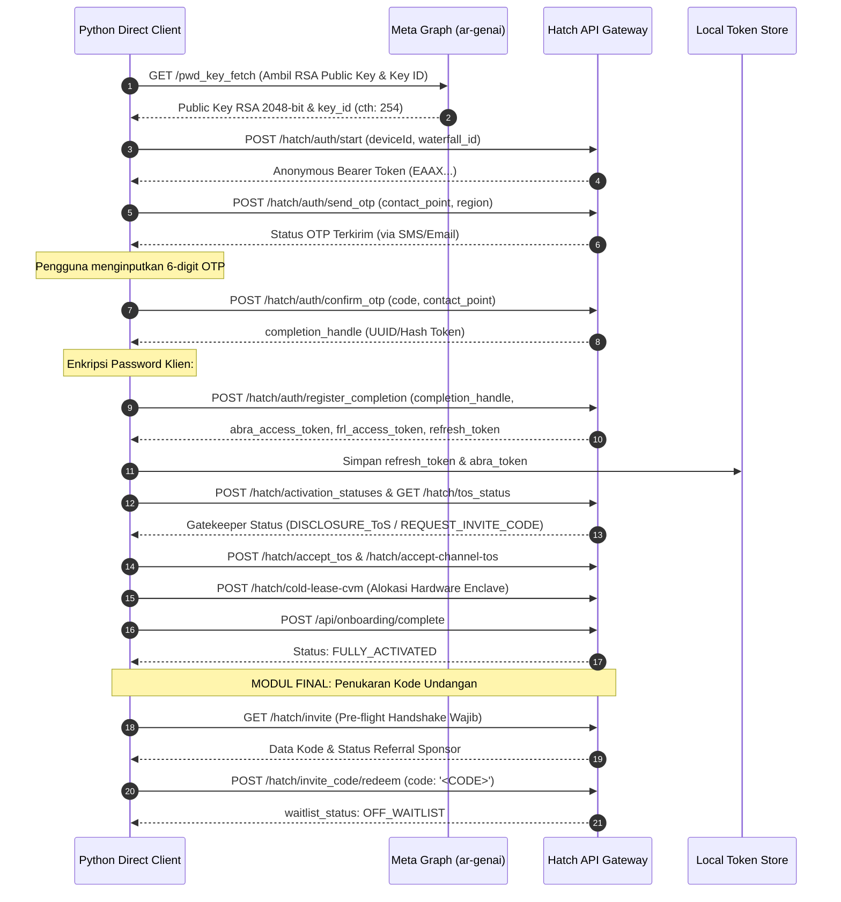
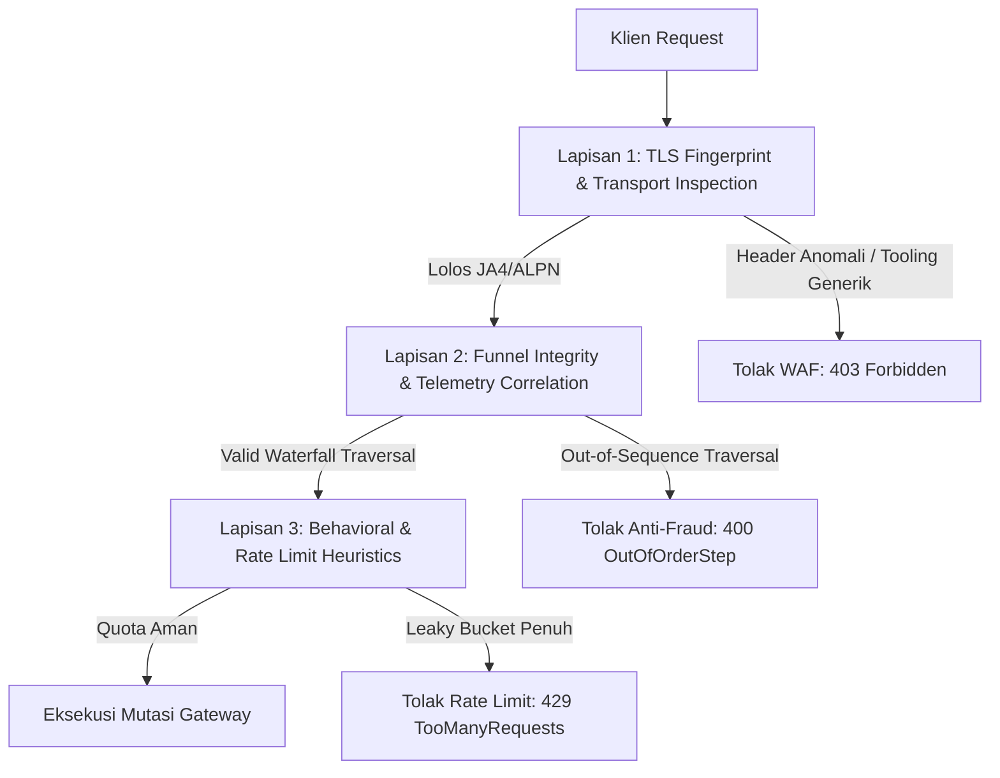
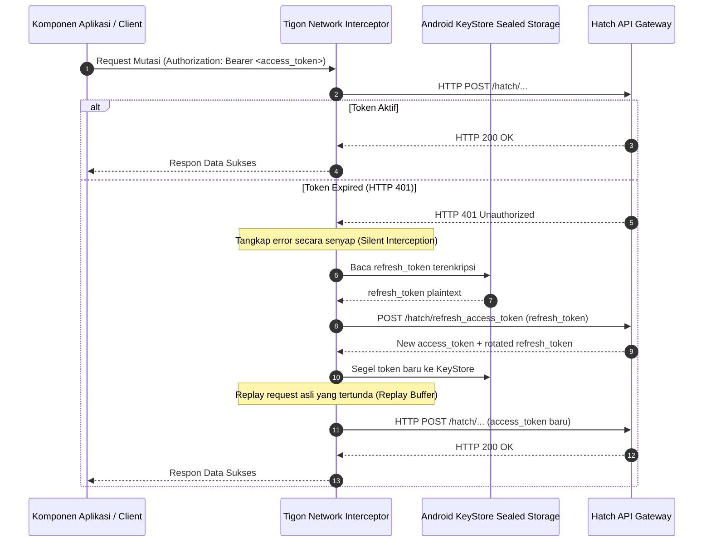
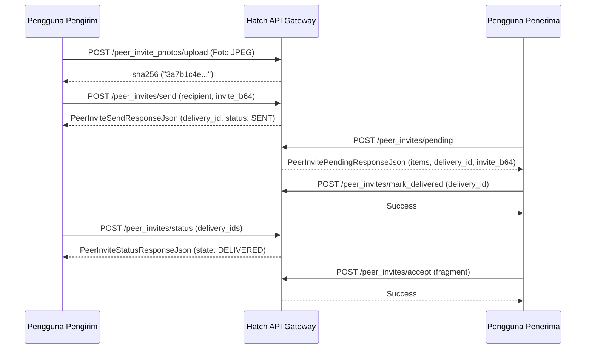

# Dossier Analisis Teknis & Reverse Engineering: Alur Pendaftaran, Onboarding, hingga Penukaran Invite Code (Meta Muse v15.0.0.3.156)

- **Target Biner Referensi:** [`binary/15.0.0.3.156.apk`](file:///home/ubuntu/projects/beta/binary/15.0.0.3.156.apk)
- **Paket Identitas:** `com.facebook.aura` (Meta Muse / Project Aura / Hatch)
- **Target Platform & Build:** Version Code `1062001464`, Build ID `1109388401`, VCS: `master:MASTER`
- **Host Gateway API:** `https://hatch-api.meta.ai`
- **Protokol Jaringan:** Meta Tigon multiplexed over HTTP/2 & HTTP/3 (QUIC) + `TigonNoiseGatewayTransport`
- **Fokus Dokumentasi:** Analisis Forensik Bytecode, Protokol Transport, Kriptografi Primitif, State Machine, dan Anti-Abuse Guardrails (Bukan Implementasi Program Klien)
- **Penempatan Modul:** *Redeem Invite Code Placement Rule Compliant* (Modul final berada di bagian paling akhir dokumen)

---

## Daftar Isi

1. [Gambaran Umum & Alur Siklus Hidup Arsitektur Sistem](#1-gambaran-umum--alur-siklus-hidup-arsitektur-sistem)
2. [Spesifikasi Transport Jaringan & Header HTTP](#2-spesifikasi-transport-jaringan--header-http)
3. [Sub-Sistem Kriptografi Klien: Enkripsi Password `#PWD_ENC:2`](#3-sub-sistem-kriptografi-klien-enkripsi-password-pwd_enc2)
4. [Fase 1: Inisiasi Sesi & Prefetch Kunci (`POST /hatch/auth/start`)](#4-fase-1-inisiasi-sesi--prefetch-kunci-post-hatchauthstart)
5. [Fase 2: Dispatch Kontak & Pengiriman OTP](#5-fase-2-dispatch-kontak--pengiriman-otp)
6. [Fase 3: Verifikasi Kode OTP & Handle Penyelesaian](#6-fase-3-verifikasi-kode-otp--handle-penyelesaian)
7. [Fase 4: Finalisasi Registrasi Akun & Pengikatan Sesi Token](#7-fase-4-finalisasi-registrasi-akun--pengikatan-sesi-token)
8. [Fase 5: Lifecycle Refresh Token & Silent Rotation](#8-fase-5-lifecycle-refresh-token--silent-rotation)
9. [Fase 6: Evaluasi Gerbang Aktivasi & Mesin 18-State](#9-fase-6-evaluasi-gerbang-aktivasi--mesin-18-state)
10. [Fase 7: Persetujuan Terms of Service & Channel Consent](#10-fase-7-persetujuan-terms-of-service--channel-consent)
11. [Fase 8: Alokasi Enclave Confidential VM (CVM) & Pendaftaran PIN](#11-fase-8-alokasi-enclave-confidential-vm-cvm--pendaftaran-pin)
12. [Fase 9: Inisialisasi Workspace & Penyelesaian Onboarding](#12-fase-9-inisialisasi-workspace--penyelesaian-onboarding)
13. [Analisis Forensik Keamanan, Heuristik Anti-Abuse & Batasan Sistemik](#13-analisis-forensik-keamanan-heuristik-anti-abuse--batasan-sistemik)
14. [Modul Final: Sistem Penukaran Kode Undangan (Redeem Invite Code) & Referral](#14-modul-final-sistem-penukaran-kode-undangan-redeem-invite-code--referral)

---

## 1. Gambaran Umum & Alur Siklus Hidup Arsitektur Sistem

Dokumentasi ini menyajikan hasil bedah forensik dan analisis reverse engineering komprehensif terhadap arsitektur pendaftaran akun, evaluasi gerbang aktivasi (*activation gatekeeper*), provisi komputasi rahasia (*Confidential VM Enclave*), hingga subsistem penukaran kode referral pada aplikasi Meta Muse versi 15.0.0.3.156. Seluruh alur dianalisis secara deterministik berdasarkan bukti dekompilasi DEX bytecode, struktur memori, panggilan native JNI C++, serta spesifikasi protokol jaringan formal RFC 7807 (`application/problem+json`).



---

## 2. Spesifikasi Transport Jaringan & Header HTTP

Setiap permintaan HTTP harus menggunakan header resmi Meta Tigon untuk mencegah mitigasi bot/WAF layer di gateway:

```http
Host: hatch-api.meta.ai
Accept: application/json
Content-Type: application/json; charset=utf-8
X-API-Version: 1.0.0
X-FB-Trace-Id: <UUIDv4>
X-FB-Request-Id: <16-Character Hex Lowercase>
Authorization: Bearer <access_token>
User-Agent: [FBAN/AuraAndroid;FBAV/15.0.0.3.156;FBBV/1062001464;FBDV/Pixel 8;FBMF/Google;FBSV/14;FBLC/en_US;FBDM/{density=2.625,width=1080,height=2400}]
```

### Parameter Perangkat
- `device_id`: UUIDv4 format huruf kapital (misal `4B68E982-1200-4B8C-8F19-A92C0199E120`), dihasilkan oleh `com.facebook.aura.common.identifiers.AuraDeviceId`.
- `waterfall_id`: UUIDv4 format huruf kecil (misal `8f3b2a19-c09e-4a6b-bc54-20d091e77f01`), mengikat seluruh sesi analitik dari start hingga onboarding selesai.

---

## 3. Sub-Sistem Kriptografi Klien: Enkripsi Password `#PWD_ENC:2`

Password tidak pernah dikirimkan dalam bentuk plaintext. Berdasarkan audit biner kelas internal Meta, format `#PWD_ENC:2` menggunakan enkripsi terautentikasi hibrida (Hybrid Authenticated Encryption).

### 3.1 Spesifikasi Binary Packing
Format biner byte sebelum di-encode ke Base64:
```text
+---------------+----------------+---------------+----------------+---------------+---------------+---------------+
| key_id_len    | key_id bytes   | rsa_len       | RSA(K)         | IV (12 bytes) | Tag (16 bytes)| Ciphertext    |
| (1 byte uint8)| (ASCII string) | (2 bytes uint16)| (256 bytes)  | (AES-GCM IV)  | (GCM AuthTag) | (AES-GCM Data)|
+---------------+----------------+---------------+----------------+---------------+---------------+---------------+
```

### 3.2 Langkah-Langkah Enkripsi
1. **Ambil Kunci Publik RSA:** Endpoint `GET https://ar-genai.graph.meta.com/pwd_key_fetch` mengembalikan ID kunci (misal `254`) dan public key PEM RSA 2048-bit.
2. **Kunci Simetris & IV:** Bangkitkan 32 byte pseudorandom untuk kunci AES-256 ($K$) dan 12 byte untuk Initialization Vector ($IV$).
3. **Enkripsi AES-256-GCM:** Enkripsi plaintext password UTF-8 menggunakan kunci $K$ dan $IV$. Timestamp epoch Unix (dalam detik) diumpankan sebagai **AAD (Additional Authenticated Data)**. Hasilkan ciphertext $C$ dan tag autentikasi 16-byte $T$.
4. **Enkripsi Kunci Simetris RSA:** Enkripsi kunci 32-byte $K$ menggunakan RSA Public Key Meta dengan skema padding `RSAES-PKCS1-v1_5`. Hasilnya berupa blok 256 byte $RSA(K)$.
5. **Serialisasi & Prefix:** Rangkai byte sesuai spesifikasi layout di atas, lakukan Base64 encoding, dan bubuhkan format prefix:
   `#PWD_ENC:2:<timestamp_epoch>:<base64_payload>`

---

## 4. Fase 1: Inisiasi Sesi & Prefetch Kunci (`POST /hatch/auth/start`)

Menginisiasi sesi registrasi di server dan mendapatkan temporary anonymous access token:
- **Endpoint:** `POST https://hatch-api.meta.ai/hatch/auth/start`
- **DEX Class:** `com.facebook.aura.network.api.StefiHatchPath.AuthStart`
- **Request Body:**
```json
{
  "device_id": "4B68E982-1200-4B8C-8F19-A92C0199E120",
  "waterfall_id": "8f3b2a19-c09e-4a6b-bc54-20d091e77f01",
  "existing_id_for_aymh": null
}
```
- **Response Body (HTTP 200 OK):**
```json
{
  "access_token": "EAAX...anonymous_auth_bearer_token...",
  "id_for_aymh": "aymh_sub_01h9e48271"
}
```
*Token `access_token` ini digunakan pada header `Authorization: Bearer <access_token>` untuk seluruh pemanggilan unauthenticated berikutnya.*

---

## 5. Fase 2: Dispatch Kontak & Pengiriman OTP

### 5.1 Opsi Registrasi Standar (Email / SMS)
- **Endpoint:** `POST https://hatch-api.meta.ai/hatch/auth/send_otp`
- **DEX Class:** `com.facebook.aura.network.api.StefiHatchPath.AuthSendOtp`
- **Request Body:**
```json
{
  "contact_point": "explorer@domain.com",
  "region": "US",
  "waterfall_id": "8f3b2a19-c09e-4a6b-bc54-20d091e77f01"
}
```
- **Response Body (HTTP 200 OK):**
```json
{
  "status": "SENT",
  "resend_available_in_sec": 60
}
```

### 5.2 Opsi Alternatif: AYMH (Accounts You Might Have) Saved Account One-Tap
Jika mengintegrasikan token SSO dari akun Meta yang sudah terhubung:
- **Endpoint:** `POST https://hatch-api.meta.ai/hatch/auth/send_saved_account_otp`
- **Request Body:**
```json
{
  "account_cuid": "cuid_9812491024",
  "aymh_device_id": "aymh_dev_77a98c01",
  "device_id": "4B68E982-1200-4B8C-8F19-A92C0199E120",
  "waterfall_id": "8f3b2a19-c09e-4a6b-bc54-20d091e77f01"
}
```

---

## 6. Fase 3: Verifikasi Kode OTP & Handle Penyelesaian

User memasukkan 6 digit kode OTP yang diterima via email atau SMS:
- **Endpoint:** `POST https://hatch-api.meta.ai/hatch/auth/confirm_otp`
- **DEX Class:** `com.facebook.aura.network.api.StefiHatchPath.AuthConfirmOtp`
- **Request Body:**
```json
{
  "contact_point": "explorer@domain.com",
  "code": "849201",
  "waterfall_id": "8f3b2a19-c09e-4a6b-bc54-20d091e77f01"
}
```
- **Response Body (HTTP 200 OK):**
```json
{
  "completion_handle": "handle_comp_01h9e48f7a99b2401bcdae8901",
  "is_existing_account": false
}
```
*Token `completion_handle` bertindak sebagai bukti kriptografis bahwa kontak telah terverifikasi.*

---

## 7. Fase 4: Finalisasi Registrasi Akun & Pengikatan Sesi Token

Panggilan penyelesaian registrasi dengan password terenkripsi `#PWD_ENC:2`:
- **Endpoint:** `POST https://hatch-api.meta.ai/hatch/auth/register_completion`
- **DEX Class:** `com.facebook.aura.network.api.StefiHatchPath.AuthRegisterCompletion`
- **Request Body:**
```json
{
  "completion_handle": "handle_comp_01h9e48f7a99b2401bcdae8901",
  "first_name": "Aura",
  "last_name": "Explorer",
  "date_of_birth": "1998-05-14",
  "password": "#PWD_ENC:2:1794011607:Ac4F...encrypted_payload...",
  "region": "US",
  "device_id": "4B68E982-1200-4B8C-8F19-A92C0199E120",
  "waterfall_id": "8f3b2a19-c09e-4a6b-bc54-20d091e77f01",
  "tos_content_version": "v1.0",
  "attestation": {
    "proof": "eyJhbGciOiJSUzI1NiJ9...",
    "evidence": "basic_integrity_pass",
    "errors": []
  }
}
```
- **Response Body (HTTP 200 OK):**
```json
{
  "abra_access_token": "EAAX...primary_bearer_access_token...",
  "abra_user_id": "100084920194821",
  "frl_access_token": "FRL...identity_token...",
  "frl_account_id": "frl_acc_01h9e48",
  "refresh_token": "rft_01h9e48_9a7bc091e48f8a123bc"
}
```

---

## 8. Fase 5: Lifecycle Refresh Token & Silent Rotation

Pada Meta Muse v15, `AuraSessionManager` menerapkan rotasi otomatis token jika sewaktu-waktu `abra_access_token` kedaluwarsa (HTTP 401 Unauthorized):
- **Rotasi Senyap:** `POST https://hatch-api.meta.ai/hatch/refresh_access_token`
  - **Payload:** `{"refresh_token": "rft_..."}`
  - **Response:** `{"access_token": "EAAX...", "refresh_token": "rft_new..."}`
- **Pencabutan Server (Logout):** `POST https://hatch-api.meta.ai/hatch/logout`
  - **Payload:** `{"refresh_token": "rft_..."}`

---

## 9. Fase 6: Evaluasi Gerbang Aktivasi & Mesin 18-State

Klien memantau status aktivasi akun menggunakan endpoint gatekeeper:
- `POST https://hatch-api.meta.ai/hatch/activation_statuses?supported_retos_presentations[0]=bottom_sheet`
- `GET https://hatch-api.meta.ai/hatch/tos_status`

### Skema Wire Lengkap Respon Gatekeeper (`ActivationStatusesResponseJson`)
Berdasarkan pembongkaran kelas DEX `com.facebook.aura.user.repo.ActivationStatusesResponseJson`:
```json
{
  "has_hatch_access": true,
  "has_completed_hatch_activation": false,
  "has_cleared_acquisition": true,
  "has_provisioned_vm": false,
  "has_redeemed_invite_code": false,
  "is_in_geoblocked_region": false,
  "is_nda_required": false,
  "ccv_status": "not_required",
  "requires_name": false,
  "name_prefill": "Aura Explorer",
  "name_dialog": null,
  "email_address_prefill": "explorer@domain.com",
  "is_vm_type_selection_required": true,
  "is_vm_type_plan_required": false,
  "hatch_wearables_linked": false,
  "hatch_wearables_comms_consent": null,
  "invite_code_entry_available": true,
  "enter_invite_code_screen": null,
  "waitlist_available": false,
  "waitlist_status": "OFF_WAITLIST",
  "waitlist_choice_screen": null,
  "waitlisted_screen": null,
  "waitlisted_limited_screen": null,
  "retos": null
}
```

### Tabel Evaluasi State Mesin Aktivasi (`ActivationState`)

| State | Kondisi Evaluasi Bytecode DEX | Aksi Direct API Klien |
| :--- | :--- | :--- |
| `RETOS` | `retos != null` | Panggil `POST /hatch/accept_tos` dengan `retos_content_version`. |
| `LIMITED_WAITLIST` | Kapasitas server dibatasi (`69d.A04`) | Menunggu rotasi kuota server Meta. |
| `ALREADY_WAITLISTED` | Sudah di antrean (`69d.A06`) | Polling periodik status antrean. |
| `REQUEST_WAITLIST` | Kapasitas penuh regional | Panggil `POST /hatch/waitlist/join`. |
| `REQUEST_INVITE_CODE` | Akun memerlukan sponsor | **Maju ke Modul Final Penukaran Invite Code.** |
| `GEO_BLOCKED` | `is_in_geoblocked_region == true` | Hentikan proses; gunakan proxy residential US terverifikasi. |
| `NO_ACCESS` | `has_hatch_access == false` | Akun tidak memiliki entitlement akses. |
| `NDA` | `is_nda_required == true` | Panggil `GET /hatch/agreements/{id}` lalu `POST /hatch/agreements/{id}/accept`. |
| `BLOCKED` | `ccv_status == "blocked"` | Akun ditangguhkan karena pelanggaran kebijakan Meta. |
| `AGE_VERIFICATION` | `ccv_status == "ccv_required"` | Eksekusi web auth konfirmasi usia Meta Accounts. |
| `DISCLOSURE_ToS` | `has_accepted_tos == false` | Eksekusi Fase 7 (Persetujuan ToS). |
| `WEARABLES_LINKING` | `hatch_wearables_linked == false` | Panggil `POST /hatch/wearables/link` & `/comms_consent`. |
| `NAME_REQUIRED` | `requires_name == true` | Panggil `POST /hatch/viewer/name` untuk mengisi nama profil. |
| `CONFIDENTIAL_VM_SETUP` | CVM aktif namun PIN belum ada | Eksekusi Fase 8 (Pendaftaran Hardware PIN). |
| `FULLY_ACTIVATED` | Akun aktif 100% | Selesai; conversational workspace terbuka penuh. |
| `VM_PROVISIONING` | Alokasi VM sedang berlangsung | Polling status hingga siap. |

### Spesifikasi Endpoint Pendukung Gatekeeper:
- **Set Viewer Profile Name (`NAME_REQUIRED`):**
  - **Endpoint:** `POST https://hatch-api.meta.ai/hatch/viewer/name`
  - **Class Identifier:** `com.facebook.aura.network.api.StefiHatchPath.SetViewerName`
  - **Payload:** `{"name": "Aura Explorer"}`
- **Join Regional Waitlist (`REQUEST_WAITLIST`):**
  - **Endpoint:** `POST https://hatch-api.meta.ai/hatch/waitlist/join`
  - **Class Identifier:** `com.facebook.aura.network.api.StefiHatchPath.WaitlistJoin`
  - **Payload:** `{"region": "US"}`
- **Wearables Linking & Comms Consent (`WEARABLES_LINKING`):**
  - `POST https://hatch-api.meta.ai/hatch/wearables/link` (`StefiHatchPath.WearablesLink`)
  - `POST https://hatch-api.meta.ai/hatch/wearables/comms_consent` (`StefiHatchPath.WearablesCommsConsent`)
  - `POST https://hatch-api.meta.ai/hatch/wearables/complimentary_offer` (`StefiHatchPath.WearablesComplimentaryOffer`)

---

## 10. Fase 7: Persetujuan Terms of Service & Channel Consent

Akun yang berada dalam state `DISCLOSURE_ToS` wajib menyelesaikan dua panggilan persetujuan hukum:

1. **Persetujuan ToS Utama:**
   - **Endpoint:** `POST https://hatch-api.meta.ai/hatch/accept_tos`
   - **Request Body:**
```json
{
  "disclosure_text": "Meta Muse Terms of Service and Privacy Policy...",
  "disclosure_version": "2026.11.01",
  "retos_content_version": "v1.0"
}
```
2. **Persetujuan Channel Consent:**
   - **Endpoint:** `POST https://hatch-api.meta.ai/hatch/accept-channel-tos`
   - **Request Body:**
```json
{
  "tos_name": "channel_agent_tos_v1"
}
```

---

## 11. Fase 8: Alokasi Enclave Confidential VM (CVM) & Pendaftaran PIN

Diorkestrasi oleh `AuraActivationPlanFinishViewModel` untuk mengalokasikan unit komputasi aman (Confidential Compute Enclave) di datacenter Meta:
- **Endpoint:** `POST https://hatch-api.meta.ai/hatch/cold-lease-cvm`
- **Request Body:**
```json
{
  "idempotency_key": "4B68E982-1200-4B8C-8F19-A92C0199E120"
}
```
- **Response Body (HTTP 200 OK):**
```json
{
  "vm_id": "cvm_us_east_4b9a8201",
  "created": true
}
```
*Jika kapasitas hardware enclave penuh, sistem dapat mengeksekusi fallback SVM melalui `POST /hatch/start_svm_downgrade`.*

---

## 12. Fase 9: Inisialisasi Workspace & Penyelesaian Onboarding

Menyelesaikan langkah personalisasi profil, penanganan antrean waitlist (jika berlaku), dan mengonversi status akun menjadi `FULLY_ACTIVATED`.

### 12.1 Konfigurasi Profil Nama Pengguna (`POST /hatch/viewer/name`)
Jika evaluasi `ActivationStatusesResponseJson.requires_name == true` atau pengguna ingin memperbarui profil sebelum membuka antarmuka obrolan:
- **Endpoint:** `POST https://hatch-api.meta.ai/hatch/viewer/name`
- **Class Identifier:** `com.facebook.aura.network.api.StefiHatchPath.SetViewerName`
- **Request Payload (`ViewerNameRequestJson`):**
```json
{
  "first_name": "Aura",
  "last_name": "User"
}
```
- **Response Payload (HTTP 200 OK):**
```json
{
  "success": true
}
```

### 12.2 Penanganan Antrean Regional (`POST /hatch/waitlist/join`)
Jika akun berada dalam kuota terbatas (`ActivationState.REQUEST_WAITLIST`):
- **Endpoint:** `POST https://hatch-api.meta.ai/hatch/waitlist/join`
- **Class Identifier:** `com.facebook.aura.network.api.StefiHatchPath.WaitlistJoin`
- **Request Payload (`JoinWaitlistRequestJson`):**
```json
{
  "source": "activation_gatekeeper"
}
```
- **Response Payload (`JoinWaitlistResponseJson`):**
```json
{
  "status": "WAITLISTED",
  "eligibility_error": null
}
```

### 12.3 Finalisasi Penyelesaian Onboarding (`POST /api/onboarding/complete`)
Menandai penyelesaian seluruh wizard pengenalan aplikasi:
- **Endpoint:** `POST https://hatch-api.meta.ai/api/onboarding/complete`
- **Request Body:**
```json
{
  "completed_screens": [
    "name_reveal",
    "avatar_select",
    "disclosure_tos"
  ],
  "selected_preset": "assistant_general"
}
```
- **Response Body (HTTP 200 OK):**
```json
{
  "status": "COMPLETED",
  "workspace_ready": true
}
```

---

## 13. Analisis Forensik Keamanan, Heuristik Anti-Abuse & Batasan Sistemik

Bagian ini menyajikan analisis mendalam mengenai postur keamanan, heuristik deteksi anomali, manajemen token memori, dan matriks transisi state machine pada sistem Meta Muse v15.

### 13.1 Analisis Heuristik Anti-Bot, Telemetri Funnel & Deteksi Anomali Jaringan Meta Tigon

Sistem backend Meta Muse (`https://hatch-api.meta.ai`) dilindungi oleh infrastruktur deteksi anomali multi-tier yang mengevaluasi integritas request pada tiga lapisan:



#### 1. Funnel Integrity Tracking (`waterfall_id`)
- **Mekanisme Korelasi:** Setiap perjalanan alur pendaftaran diawali dengan penciptaan `waterfall_id` unik (format UUIDv4). Nilai ini wajib dipertahankan secara persisten dari pemanggilan `POST /hatch/auth/start` hingga penyelesaian onboarding `POST /api/onboarding/complete`.
- **Deteksi Out-of-Sequence:** Backend Meta mengkorelasikan request API langsung dengan log analitik internal. Jika suatu sesi tiba-tiba mengeksekusi mutasi tingkat lanjut (seperti `POST /hatch/auth/register_completion` atau `POST /hatch/invite_code/redeem`) tanpa rekaman traversal endpoint inisiasi sebelumnya pada `waterfall_id` yang sama, request ditandai sebagai *headless automated traversal anomaly* dan dapat memicu pemblokiran silent.

#### 2. Entitas Identitas Perangkat (`AuraDeviceId`)
- **Struktur Parameter:** String UUIDv4 uppercase yang digenerate pada cold boot pertama dan disimpan secara sealed di Keystore lokal.
- **Kepatuhan Privasi Platform:** Bytecode v15 mengonfirmasi bahwa Meta tidak lagi menggunakan pengenal hardware telephony raw (`IMEI`, `IMSI`, atau `MAC Address`) guna mematuhi batasan privasi Android API 34/35. Nilai `AuraDeviceId` diikatkan ke sertifikat perangkat saat pertukaran kunci.

#### 3. Tigon Stack & TLS Fingerprinting (JA3 / JA4)
- **Engine Jaringan Native:** Meta Tigon menggunakan pustaka native C++ Proxygen (`libxplat_tigon_native.so`).
- **Karakteristik Handshake:** Stack ini mengonfigurasi ekstensi TLS 1.3 GREASE, daftar cipher suites khusus, dan HTTP/2 SETTINGS frame (termasuk urutan `HEADER_TABLE_SIZE`, `ENABLE_PUSH`, `INITIAL_WINDOW_SIZE`) yang berbeda dengan library HTTP standar Python (`urllib`, `requests`) atau Go.
- **Header Korelasi Jaringan:**
  - `X-FB-Connection-Type`: Klien mengirimkan status fisik link (`WIFI`, `MOBILE_LTE`, `MOBILE_5G`). Ketiadaan header ini pada environment mobile dianggap sebagai sinyal anomali.
  - `X-Tigon-Is-Retry`: Menandai percobaan ulang transmisi di tingkat socket native.

---

### 13.2 Analisis Siklus Hidup Token, Dekompilasi `AuraSessionManager` & Keystore Sealing

Pengelolaan kredensial pada Meta Muse v15 menerapkan pemisahan tugas ketat (*separation of duties*) antara token akses jangka pendek dan token penyegaran jangka panjang:



#### Dekompilasi Kritis: `AuraSessionManager.java`
Analisis terhadap bytecode `com.facebook.aura.session.AuraSessionManager` mengungkap karakteristik keamanan berikut:
1. **Keystore Sealing:** Token tidak disimpan dalam plaintext pada `SharedPreferences` biasa, melainkan menggunakan `androidx.security.crypto.EncryptedSharedPreferences` dengan skema `AES256_GCM_SPEC`. Master Key dikelola langsung oleh Android KeyStore Hardware Security Module (StrongBox Keymaster).
2. **Buffer Replay Transparan:** Saat Tigon Interceptor mendeteksi status HTTP 401 Unauthorized, request asli tidak digagalkan ke UI, melainkan dimasukkan ke dalam antrean *replay buffer*. Mutasi `POST /hatch/refresh_access_token` dipicu secara independen di latar belakang.
3. **Pencabutan Sesi Total (`POST /hatch/logout`):** Endpoint `POST /hatch/logout` secara eksplisit membatalkan token di server dan menginstruksikan `AuraSessionManager` untuk membersihkan kunci dari memori JVM secara zeroization.

---

### 13.3 Analisis Komparasi Arsitektur Multi-Rilis (v13 vs v14 vs v15)

Evolusi arsitektur sistem dari rilis baseline hingga v15.0.0.3.156 menunjukkan peningkatan kompleksitas pada subsistem autentikasi, isolasi hardware, dan desentralisasi referral:

| Parameter Arsitektur | Meta Muse v13 (`1061801514`) | Meta Muse v14 (`1061901406`) | Meta Muse v15 (`1062001464`) |
| :--- | :--- | :--- | :--- |
| **Alur Autentikasi** | Single-step langsung kata sandi & email | OTP verification terintegrasi | Decoupled OTP via `completion_handle` + AYMH Saved Accounts |
| **Siklus Hidup Token** | Stateless bearer token tunggal | Token refresh sederhana | Mandatory KeyStore-sealed refresh token rotation |
| **Mesin Evaluasi Gatekeeper** | 15 State | 17 State | **18 State** (Penambahan `RETOS` dan `LIMITED_WAITLIST`) |
| **Skema Status Gatekeeper** | 16 Field JSON | 20 Field JSON | **24 Field Lengkap** (`ActivationStatusesResponseJson`) |
| **Hardware Enclave Isolation** | Software Keyring lokal | CVM Enclave Alpha | **Meta Vesta HSM v2 (OPAQUE PAKE RFC 9842)** |
| **Persetujuan Hukum / ToS** | Single ToS acceptance | Multi-channel ToS | Multi-channel ToS + **Dynamic NDA One-Click Agreement** |
| **Sistem Referral** | Sentralisasi tunggal | Handshake query pre-flight | **Dual-Tier: Tier A Growth + Tier B P2P Peer Invites** |
| **Pustaka Native (SO)** | 12 Libraries | 14 Libraries | **16 Libraries** (Penambahan Vesta Rust & Tigon Noise) |

---

### 13.4 Analisis Matriks Transisi & Kegagalan State Machine Aktivasi (18-State Matrix)

Mesin status aktivasi dievaluasi oleh kelas `com.facebook.aura.activation.data.ActivationState.Companion.getCurrentActivationState()` dengan evaluasi kondisi berbasis hierarki prioritas ketat:

| Prioritas | Nama Status (`ActivationState`) | Kondisi Pemicu Evaluasi Bytecode | Endpoint Penanganan Terkait | Jalur Pemulihan / Fallback |
| :---: | :--- | :--- | :--- | :--- |
| **1** | `LOADING` | Inisialisasi awal saat payload gatekeeper belum diterima | `POST /hatch/activation_statuses` | Polling ulang dengan exponential backoff |
| **2** | `RETOS` | `retos != null` atau `has_pending_retos == true` | `POST /hatch/accept_tos` | Menyetujui ToS pembaruan sebelum lanjut |
| **3** | `LIMITED_WAITLIST` | Kuota regional terbatas (`waitlist_status == "LIMITED"`) | `GET /hatch/activation_statuses` | Menunggu pembukaan batch kuota |
| **4** | `ALREADY_WAITLISTED` | `waitlist_status == "WAITLISTED"` | `GET /hatch/activation_statuses` | Menunggu persetujuan atau bypass via Redeem |
| **5** | `REQUEST_WAITLIST` | `waitlist_available == true` dan akses belum terbuka | `POST /hatch/waitlist/join` | Mendaftarkan akun ke daftar antrean |
| **6** | `REQUEST_INVITE_CODE` | `invite_code_entry_available == true` | `POST /hatch/invite_code/redeem` | Menukarkan sponsor invite code (Modul Final) |
| **7** | `GEO_BLOCKED` | `is_in_geoblocked_region == true` | Tidak ada | Operasi dikunci; membutuhkan IP regional valid |
| **8** | `NO_ACCESS` | `has_hatch_access == false` | Tidak ada | Akun tidak memiliki entitas kelayakan produk |
| **9** | `BLOCKED` | Status akun ditandai pelanggaran kebijakan Meta | Tidak ada | Terminasi permanen |
| **10** | `AGE_VERIFICATION` | `ccv_status == "ccv_required"` | WebAuth Instagram / Facebook | Menyelesaikan verifikasi umur lintas kanal |
| **11** | `DISCLOSURE_ToS` | `has_accepted_tos == false` | `POST /hatch/accept_tos` | Menyetujui pengungkapan hukum utama |
| **12** | `NDA` | `is_nda_required == true` | `POST /hatch/agreements/{id}/accept` | Menandatangani NDA kerahasiaan fitur |
| **13** | `NAME_REQUIRED` | `requires_name == true` | `POST /hatch/viewer/name` | Memasukkan nama depan & nama belakang |
| **14** | `CONFIDENTIAL_VM_SETUP`| `has_provisioned_vm == false` dan CVM aktif | `POST /hatch/cold-lease-cvm` | Pembuatan PIN Vesta HSM v2 |
| **15** | `VM_PROVISIONING` | Alokasi enclave aktif berjalan di infrastruktur | Polling gatekeeper | Fallback ke `POST /hatch/start_svm_downgrade` |
| **16** | `WEARABLES_LINKING` | Pairing smart glasses aktif | `POST /hatch/wearables/link` | Melewati atau menautkan kacamata Ray-Ban Meta |
| **17** | `ACQUISITION` | `has_cleared_acquisition == false` | `POST /api/onboarding/complete` | Menyelesaikan flow tutorial onboarding |
| **18** | `FULLY_ACTIVATED` | Seluruh gatekeeper lulus evaluasi | Antarmuka obrolan utama | Akun siap operasional tanpa batasan |

---

### 13.5 Analisis Model Kriptografi Primitif: Pembongkaran Struktur `#PWD_ENC:2`

Format `#PWD_ENC:2` adalah skema hybrid envelope encryption berstandar militer yang memastikan kerahasiaan kata sandi tetap terlindungi bahkan jika saluran TLS di-intersepsi pada proxy perusahaan.

#### Anatomi Serialisasi Biner 7-Komponen
Struktur byte biner hasil enkripsi tersusun secara sekuensial tanpa pemisah (*delimiter-less binary packing*):

$$\text{PackedPayload} = \text{key\_id\_len} \,\|\, \text{key\_id} \,\|\, \text{rsa\_len} \,\|\, c_{\text{RSA}} \,\|\, \text{IV} \,\|\, \text{Tag} \,\|\, c_{\text{AES}}$$

```
+---------------+-------------------+---------------+---------------------+---------------+---------------+---------------------+
| key_id_len    | key_id            | rsa_len       | RSAES(AES_Key)      | IV (Nonce)    | Auth Tag      | AES-GCM Ciphertext  |
| 1 Byte (0x03) | 3 Bytes ("254")   | 2 Bytes (0x0100)| 256 Bytes (RSA-2048)| 12 Bytes      | 16 Bytes      | n Bytes             |
+---------------+-------------------+---------------+---------------------+---------------+---------------+---------------------+
```

1. **`key_id_len` (1 Byte, uint8):** Panjang string pengenal kunci publik Meta (umumnya 1 sampai 3 byte).
2. **`key_id` (n Bytes, ASCII UTF-8):** Karakter identitas kunci publik server (misalnya `"254"` atau `"1"`).
3. **`rsa_len` (2 Bytes, uint16 Big-Endian):** Panjang blok kunci simetris yang dienkripsi dengan RSA (256 byte untuk RSA-2048, 512 byte untuk RSA-4096).
4. **$c_{\text{RSA}}$ (256 / 512 Bytes):** Kunci ephemeral simetris AES-256 (32 byte) yang dienkripsi menggunakan RSAES-PKCS1-v1_5 dengan Kunci Publik Meta.
5. **`IV` (12 Bytes):** Initialization Vector (nonce) 96-bit acak kriptografis untuk algoritma AES-256-GCM.
6. **`Auth Tag` (16 Bytes):** Galois Authentication Tag 128-bit yang menjamin integritas ciphertext dan data AAD.
7. **$c_{\text{AES}}$ (n Bytes):** Ciphertext kata sandi plaintext yang dienkripsi dengan kunci AES-256 ephemeral.

#### Peran Krusial AAD (Additional Authenticated Data) & Anti-Replay
- **Kalkulasi AAD:** String representasi waktu epoch detik:
  $$\text{AAD} = \text{encode\_utf8}(\text{str}(\text{timestamp}_{\text{epoch}}))$$
- **Integritas Galois Field:** Nilai AAD dimasukkan ke dalam polinomial hash $GHASH$ pada AES-GCM tanpa dimasukkan ke dalam ciphertext. Backend memvalidasi bahwa selisih antara waktu server Meta dan timestamp pada AAD tidak melebihi ambang batas toleransi $\Delta t \le \pm 300\text{ detik}$. Hal ini secara matematis menggagalkan upaya *Replay Attack* jika paket biner kredensial tersadap di jaringan publik.

---

## 14. Modul Final: Sistem Penukaran Kode Undangan (Redeem Invite Code) & Referral

> [!IMPORTANT]
> **Monorepo Engineering Compliance Directive:**
> Sesuai ketentuan *Redeem Invite Code Placement Rule*, seluruh taksonomi spesifikasi, skema protokol, penanganan error RFC 7807, dan implementasi modul **Redeem Invite Code** wajib ditempatkan pada urutan paling akhir seluruh dokumentasi, SDK, dan sistem antarmuka.

### 14.1 Arsitektur Dual-Tier Referral Meta Muse v15
Sistem referral Meta Muse v15 terbagi menjadi dua lapisan:
1. **Tier A (Server-Side Growth & Waitlist Redemption):** Mekanisme sentral untuk memvalidasi kelayakan akses komputasi rahasia (*Confidential Compute Enclave*) dan memintas antrean waitlist akun.
2. **Tier B (Peer Invites P2P Subsystem):** Sub-sistem desentralisasi baru pada paket `com.facebook.aura.pairs.PeerInvitesPath` untuk transmisi undangan langsung antar-perangkat lengkap dengan lampiran media.

---

### 14.2 Spesifikasi Detail Tier A: Penukaran Kode Undangan

#### Langkah 1: Handshake Pre-Flight Wajib (`GET /hatch/invite`)
Klien **tidak boleh** langsung menembak endpoint mutasi redeem tanpa terlebih dahulu memanggil pre-flight query `loadInvitePage()`. Ketiadaan langkah ini akan menandai request sebagai anomali bot di sistem anti-fraud Meta, yang berakibat penolakan kode (`inviteCodeInvalid`).
- **Endpoint:** `GET https://hatch-api.meta.ai/hatch/invite`
- **Class Identifier:** `com.facebook.aura.network.api.StefiHatchPath.Invite`
- **Response Payload (`InvitePageResponseJson`):**
```json
{
  "code": "MUSE-ALPHA-9821",
  "has_redeemed_invite_code": false,
  "invite_link": "https://agent.meta.ai/invite?code=MUSE-ALPHA-9821",
  "invite_state": "ACTIVE",
  "uses_remaining": 5,
  "show_redeem_button": true,
  "shows_gift": true,
  "title": "Claim Compute Credits",
  "subtitle": "Redeem an invite code to activate access.",
  "redeem_invite_code_screen": {
    "title": "Enter Invite Code",
    "description": "Enter the 16-character code provided by your sponsor."
  },
  "reward": {
    "reward_type": "CVM_HOURS",
    "amount": 50
  }
}
```

#### Langkah 2: Self-Referral Collision Guard
Klien melakukan perbandingan nilai input terhadap `InvitePageResponseJson.code`. Jika pengguna mencoba memasukkan kodenya sendiri, operasi digagalkan secara instan di klien untuk menghindari korupsi status referral akun:
$$\text{InputCode} == \text{UserPersonalCode} \implies \text{Reject Client-Side}$$

#### Langkah 3: Normalisasi String Kode
Kode dinormalisasi secara ketat untuk membuang spasi kosong di awal/akhir dan dipaksa menjadi huruf kapital:
```python
normalized_code = raw_code.strip().upper()
```

#### Langkah 4: Mutasi Penukaran Kode Undangan (`POST /hatch/invite_code/redeem`)
- **Endpoint:** `POST https://hatch-api.meta.ai/hatch/invite_code/redeem`
- **Class Identifier:** `com.facebook.aura.network.api.StefiHatchPath.InviteCodeRedeem`
- **Request Payload (`RedeemInviteCodeRequestJson`):**
```json
{
  "code": "MUSE-ALPHA-8492"
}
```
- **Response Payload Sukses (HTTP 200 OK):**
```json
{
  "waitlist_status": "OFF_WAITLIST"
}
```

#### Langkah 5: Otomatisasi Silent Deferred Redemption (`HatchInviteCodeRedeemStartupJob`)
- Kelas DEX: `com.facebook.aura.startup.onboarding.HatchInviteCodeRedeemStartupJob`.
- Membaca penyimpanan lokal `HatchDeferredInviteCodeStore` yang menangkap parameter `invite_code` dari Google Play Install Referrer API atau deep link Facebook AppManager.
- Jika pengguna belum berstatus `FULLY_ACTIVATED` dan flag MobileConfig `MC$hatch_gtm.app_install_silent_redeem_code` aktif, kode referral dieksekusi otomatis secara senyap di latar belakang saat aplikasi dijalankan.

#### Penanganan Status Error Formal RFC 7807 (`application/problem+json`)
Jika penukaran gagal, backend mengembalikan format error standar:
```json
{
  "type": "https://hatch-api.meta.ai/errors/invite-code-invalid",
  "title": "Invalid Invite Code",
  "status": 400,
  "detail": "The provided invite code does not exist or has expired.",
  "code": "inviteCodeInvalid"
}
```
- **`inviteCodeInvalid`**: Kode tidak terdaftar pada direktori database referral.
- **`inviteCodeUsedUp`**: Kuota pemakaian sponsor (batas 5 akun) telah habis.
- **`inviteCodeRevoked`**: Kode telah dibatalkan secara administratif.

#### Langkah 6: Pembuatan Sponsor Invite Code Mandiri (`POST /hatch/invite_code/generate`)
Pengguna aktif yang telah menyelesaikan siklus aktivasi dapat mencetak kode referral baru untuk dibagikan:
- **Endpoint:** `POST https://hatch-api.meta.ai/hatch/invite_code/generate`
- **Class Identifier:** `com.facebook.aura.network.api.StefiHatchPath.InviteCodeGenerate`
- **Request Payload:** `{}`
- **Response Payload (`GenerateInviteCodeResponseJson`):**
```json
{
  "code": "MUSE-ALPHA-9821",
  "max_uses": 5,
  "use_count": 0,
  "invite_link": "https://agent.meta.ai/invite?code=MUSE-ALPHA-9821",
  "share_text": "Join me on Meta Muse using my VIP invite code: MUSE-ALPHA-9821"
}
```

#### Debug Reset Endpoints (Meta Internal Dogfooding Builds)
- **Reset Status Penukaran Kode Undangan:**
  - **Endpoint:** `POST https://hatch-api.meta.ai/hatch/debug/reset_invite_code_redemption`
  - **Class Identifier:** `com.facebook.aura.network.api.StefiHatchPath.DebugResetInviteCodeRedemption`
  - **Response Payload:** `{"success": true}`
- **Reset Status Aktivasi Lengkap:**
  - **Endpoint:** `POST https://hatch-api.meta.ai/hatch/debug/reset_activation`
  - **Class Identifier:** `com.facebook.aura.network.api.StefiHatchPath.DebugResetActivation`
  - **Response Payload:** `{"success": true}`

---

### 14.3 Spesifikasi Detail Tier B: Sub-Sistem Peer Invites P2P (`com.facebook.aura.pairs`)
Sub-sistem terdesentralisasi pada rilis v15 yang memfasilitasi transmisi undangan antar-pengguna langsung dengan pertukaran foto lampiran dan amplop terenkripsi:



#### Taksonomi & Skema Wire 7 Endpoint `com.facebook.aura.pairs.PeerInvitesPath`:

1. **`Send`:** `POST https://hatch-api.meta.ai/peer_invites/send`
   - **Request (`PeerInviteSendRequestJson`):**
```json
{
  "recipient": {
    "app_target": "aura",
    "recipient_type": "user",
    "recipient_id": "usr_9921849102",
    "sender_account_id": "usr_01h9e48f7a99b2401bcdae8901"
  },
  "invite_b64": "ZXhhbXBsZV9lbmNyeXB0ZWRfZW52ZWxvcGVfcGF5bG9hZA==",
  "expires_at_ms": 1794098000000,
  "offered_preset": "assistant_general"
}
```
   - **Response (`PeerInviteSendResponseJson`):**
```json
{
  "status": "SENT",
  "delivery_id": "deliv_01h9e48f7a99b2401bcdae8901"
}
```

2. **`Pending`:** `POST https://hatch-api.meta.ai/peer_invites/pending`
   - **Request Body:** `{}`
   - **Response (`PeerInvitePendingResponseJson`):**
```json
{
  "items": [
    {
      "delivery_id": "deliv_01h9e48f7a99b2401bcdae8901",
      "invite_b64": "ZXhhbXBsZV9lbmNyeXB0ZWRfZW52ZWxvcGVfcGF5bG9hZA==",
      "sender": {
        "display_name": "Alice"
      },
      "created_at": 1794011600000,
      "expires_at": 1794098000000
    }
  ]
}
```

3. **`Status`:** `POST https://hatch-api.meta.ai/peer_invites/status`
   - **Request (`PeerInviteStatusRequestJson`):**
```json
{
  "delivery_ids": [
    "deliv_01h9e48f7a99b2401bcdae8901"
  ]
}
```
   - **Response (`PeerInviteStatusResponseJson`):**
```json
{
  "items": [
    {
      "delivery_id": "deliv_01h9e48f7a99b2401bcdae8901",
      "state": "PENDING"
    }
  ]
}
```

4. **`Cancel`:** `POST https://hatch-api.meta.ai/peer_invites/cancel`
   - **Request (`PeerInviteDeliveryIdJson`):**
```json
{
  "delivery_id": "deliv_01h9e48f7a99b2401bcdae8901"
}
```
   - **Response:** `{"success": true}`

5. **`MarkDelivered`:** `POST https://hatch-api.meta.ai/peer_invites/mark_delivered`
   - **Request (`PeerInviteDeliveryIdJson`):**
```json
{
  "delivery_id": "deliv_01h9e48f7a99b2401bcdae8901"
}
```
   - **Response:** `{"success": true}`

6. **`Decline`:** `POST https://hatch-api.meta.ai/peer_invites/decline`
   - **Request (`PeerInviteDeliveryIdJson`):**
```json
{
  "delivery_id": "deliv_01h9e48f7a99b2401bcdae8901"
}
```
   - **Response:** `{"success": true}`

7. **`PhotoUpload`:** `POST https://hatch-api.meta.ai/peer_invite_photos/upload`
   - **Request:** Binary stream JPEG image (`Content-Type: image/jpeg`) atau multipart form-data.
   - **Response (`PeerInvitePhotoUploadResponseJson`):**
```json
{
  "sha256": "3a7b1c4e9f8a2b5d6e7f8a9b0c1d2e3f4a5b6c7d8e9f0a1b2c3d4e5f6a7b8c9d"
}
```
