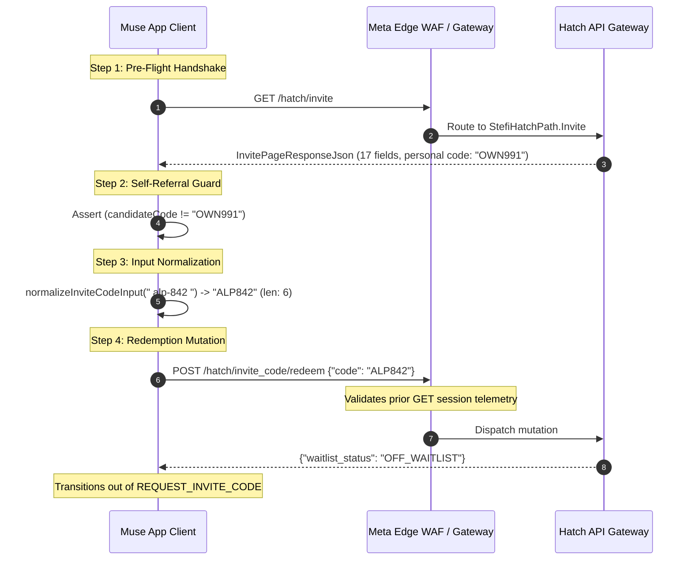
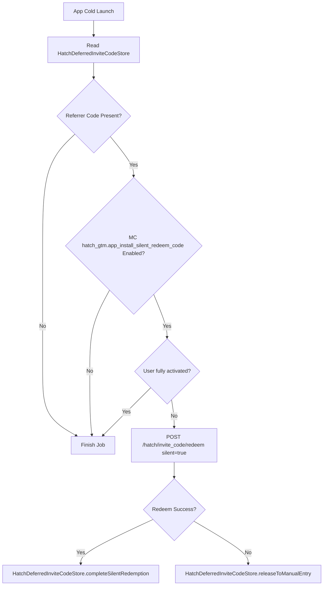

# Deep Dive Specification: Tier A Server-Side Growth & Waitlist Redemption

> [!IMPORTANT]
> **Monorepo Engineering Compliance Directive:**
> Sesuai ketentuan *Redeem Invite Code Placement Rule*, seluruh taksonomi spesifikasi, skema protokol, penanganan error RFC 7807, dan implementasi modul **Redeem Invite Code** wajib ditempatkan pada urutan paling akhir seluruh dokumentasi, repositori, dan sistem antarmuka.

---

## 1. Overview & Operational Mandates

Tier A represents the centralized growth referral pipeline of Meta Muse v15 (`com.facebook.aura`). Executed via `com.facebook.aura.network.api.StefiHatchPath.InviteCodeRedeem`, this mutation validates user access, bypasses regional waitlist queues (`ActivationState.REQUEST_INVITE_CODE`), and credits the user's account with Confidential VM compute allocations.

Decompiled bytecode analysis confirms that Tier A redemption is protected by a multi-layered verification chain combining:
- Edge pre-flight handshake queries
- Strict client-side string normalization (6-character uppercase alphanumeric)
- Self-referral collision guards
- Deferred silent background redemption via Google Play Install Referrer
- Formal RFC 7807 problem error taxonomy

---

## 2. Step-by-Step Execution Protocol



### Step 1: Pre-Flight Handshake Query (`GET /hatch/invite`)
- **DEX Identifier:** `com.facebook.aura.network.api.StefiHatchPath$Invite` (`/hatch/invite`)
- **Repository Invocation:** `AuraActivationRepository.fetchInvitePage()`
- **HTTP Method:** `GET`
- **Mandatory Handshake Requirement & Bot Rejection Guard:**
  In the decompiled UI coroutine state machine (`HatchRedeemInviteCodeViewModel`), the redemption screen starts in `RedeemPhase.Loading`. It **cannot** transition to `RedeemPhase.Entry` without a successful execution of `AuraActivationRepository.fetchInvitePage()`:
  ```kotlin
  // HatchRedeemInviteCodeViewModel.kt line 374
  redeemed = if (hatchInvitePage.hasRedeemedInviteCode) {
      RedeemPhase.Redeemed(hatchInvitePage.redeemSuccessScreen)
  } else {
      RedeemPhase.Entry(hatchInvitePage.redeemScreen, hatchInvitePage.redeemSuccessScreen)
  }
  ```
  If `GET /hatch/invite` is skipped or fails, `RedeemPhase` falls back to `RedeemPhase.LoadFailed`, disabling all input submission triggers. 
  
  On the server side, Meta's edge WAF and Tigon transport gateway track edge telemetry and request sequences. Firing `POST /hatch/invite_code/redeem` directly without the preceding `GET /hatch/invite` pre-flight query triggers an immediate anomaly classification (absence of pre-flight session cookies and telemetry headers), causing the server edge to reject the request with RFC 7807 code `inviteCodeInvalid`.

- **Exhaustive Wire Schema (`InvitePageResponseJson`):**
  Verified across 17 structured fields in `com.facebook.aura.activation.repo.InvitePageResponseJson`:
```json
{
  "invite_state": "ACTIVE",
  "title": "Claim Compute Credits",
  "subtitle": "Redeem an invite code to activate access.",
  "subtitle_link_text": "Learn more about compute credits",
  "subtitle_link_url": "https://about.meta.com/technologies/muse/credits",
  "code": "OWN991",
  "invite_link": "https://agent.meta.ai/invite?code=OWN991",
  "uses_remaining": 5,
  "share_text": "Join me on Meta Muse using my VIP invite code: OWN991",
  "story_share_text": "Get access to Meta Muse with my code OWN991",
  "show_gift": true,
  "has_redeemed_invite_code": false,
  "show_redeem_button": true,
  "reward": {
    "reward_type": "CVM_HOURS",
    "amount": 50
  },
  "gift_video": {
    "video_url": "https://video.meta.com/aura/invite_gift.mp4",
    "thumbnail_url": "https://static.meta.com/aura/invite_thumb.jpg"
  },
  "redeem_invite_code_screen": {
    "title": "Enter Invite Code",
    "description": "Enter the 6-character code provided by your sponsor."
  },
  "redeem_invite_code_success_screen": {
    "title": "Welcome to Meta Muse!",
    "description": "Your account has been activated and 50 CVM compute hours have been added to your balance."
  }
}
```

---

### Step 2: Client-Side Self-Referral Collision Guard

The client checks the candidate code against the user's personal referral code returned in `InvitePageResponseJson.code`. If a user attempts to redeem their own referral code, the client aborts immediately:

$$\text{CandidateCode} == \text{InvitePageResponseJson.code} \implies \text{Abort Locally}$$

This guard prevents circular referral loops, state machine lockouts, and unnecessary round-trips to the server gateway.

---

### Step 3: Strict Input Normalization & 6-Character Length Constraint

Decompilation of `com.facebook.aura.activation.model.InviteCodeKt` reveals the exact character validation algorithm:

```java
// com.facebook.aura.activation.model.InviteCodeKt
public abstract class InviteCodeKt {
    public static final int INVITE_CODE_LENGTH = 6;

    public static final String normalizeInviteCodeInput(String str) {
        CPK.A0k(str, 0);
        StringBuilder sb = new StringBuilder();
        int length = str.length();
        for (int i = 0; i < length; i++) {
            char cCharAt = str.charAt(i);
            if (Character.isLetterOrDigit(cCharAt)) {
                sb.append(cCharAt);
            }
        }
        String upperCase = sb.toString().toUpperCase(Locale.ROOT);
        if (upperCase.length() > 6) {
            return null;
        }
        return upperCase;
    }
}
```

**Key Architectural Rules:**
1. **Character Set Filter:** Strips punctuation, dashes, spaces, and formatting characters via `Character.isLetterOrDigit(c)`.
2. **Uppercase Conversion:** Converts all characters to uppercase (`Locale.ROOT`).
3. **Exact Length Bound:** Must not exceed `INVITE_CODE_LENGTH` (6 characters). If greater than 6 characters, `normalizeInviteCodeInput` returns `null` and rejects input.
4. **Auto-Submit Trigger:** As implemented in `HatchRedeemInviteCodeViewModel.onInviteCodeChange()`:
   ```kotlin
   if (normalizedCode.length == 6 && previousLength < 6) {
       onConfirmClick() // Dispatches immediately upon the 6th character
   }
   ```

---

### Step 4: Redemption Mutation (`POST /hatch/invite_code/redeem`)

- **DEX Identifier:** `com.facebook.aura.network.api.StefiHatchPath$InviteCodeRedeem` (`/hatch/invite_code/redeem`)
- **HTTP Method:** `POST`
- **Request Payload (`RedeemInviteCodeRequestJson`):**
```json
{
  "code": "ALP842"
}
```
- **Response Payload (`RedeemInviteCodeResponseJson` - HTTP 200 OK):**
```json
{
  "waitlist_status": "OFF_WAITLIST"
}
```
- **State Transition & Local Store Update:**
  Upon receiving `waitlist_status == "OFF_WAITLIST"`, `AuraActivationRepository.redeemInviteCode()` executes:
  ```kotlin
  updateHasRedeemedInviteCode(redeemInviteCodeResult)
  ```
  This atomically updates `AuraViewerDataProvider.userData`, transitioning the account out of `ActivationState.REQUEST_INVITE_CODE` into `ActivationState.CONFIDENTIAL_VM_SETUP` or `ActivationState.FULLY_ACTIVATED`.

- **Quick Performance Logger (QPL) Event Points:**
  Telemetry emitted via `HatchActivationQplLogger.INSTANCE`:
  - `pointFlow("invite_code_submitted")`
  - `pointFlow("invite_code_redeemed")`
  - `markInviteCodeUsed()`
  - On failure: `pointActivationStepFailed("invite_code_redeem", "mutation_error", "server_rejected_code", error, null)`

---

## 3. Deferred Silent Redemption (`HatchInviteCodeRedeemStartupJob`)

Meta Muse v15 incorporates an automated background onboarding job to handle deep links and app-store installations without requiring user intervention.

Decompilation of `com.facebook.aura.startup.onboarding.HatchInviteCodeRedeemStartupJob`:

- **Job Configuration:**
  - `Job ID:` `AppJobId.INVITE_CODE_SILENT_REDEEM`
  - `Phase:` `StartupPhase.NON_BLOCKING_HIGH_PRIORITY`
  - `Process Scope:` `ProcessScope.FOREGROUND_ONLY`
  - `Resume Policy:` `ResumePolicy.EveryResume`
  - `Execution Timeout:` 10,000 ms



1. **Source Discovery:** Reads `HatchDeferredInviteCodeStore.pendingReferrerCodeForSilentRedemption(currentTimeMs)`. This store captures deep links from the **Google Play Install Referrer API** or **Facebook AppManager** containing `invite_code=<CODE>`.
2. **Conditional Gate:** Checks MobileConfig flag `MC$hatch_gtm.app_install_silent_redeem_code`.
3. **Silent Dispatch:** Invokes `AuraActivationRepository.redeemInviteCode(code, true, true, coroutine)`.
4. **Resilience & Fallback:**
   - On HTTP 200: Marks `completeSilentRedemption(code)`.
   - On error: If the account state is not yet `FULLY_ACTIVATED`, the code is released to manual entry via `releaseToManualEntry(code)`, populating the text field on the manual entry screen when the user reaches it.

---

## 4. Sponsor Invite Code Generation (`POST /hatch/invite_code/generate`)

Users who have unlocked their accounts can generate referral codes to sponsor peers:
- **DEX Identifier:** `com.facebook.aura.network.api.StefiHatchPath$InviteCodeGenerate` (`/hatch/invite_code/generate`)
- **Trigger Condition:** Executed in `AuraInviteFriendViewModel.load()` when:
  ```kotlin
  if (hatchInvitePage.code == null && hatchInvitePage.state == HatchInviteState.ELIGIBLE) {
      generateInviteCode()
  }
  ```
- **Request Payload:** `{}`
- **Response Schema (`GenerateInviteCodeResponseJson`):**
```json
{
  "code": "ALP842",
  "max_uses": 5,
  "use_count": 0,
  "invite_link": "https://agent.meta.ai/invite?code=ALP842",
  "share_text": "Join me on Meta Muse using my VIP invite code: ALP842"
}
```
- **Telemetry:** Logged via `HatchInviteLogging.INSTANCE.logInviteCodeGenerate(generateInviteCodeResult)`.

---

## 5. RFC 7807 Error Code Taxonomy

When redemption fails, the server emits a formal RFC 7807 problem details JSON (`application/problem+json`). Decompilation of `com.facebook.aura.activation.repo.InviteCodeServerErrorKt` reveals the exact mapping:

```json
{
  "type": "https://hatch-api.meta.ai/errors/inviteCodeInvalid",
  "title": "Invalid Invite Code",
  "status": 400,
  "detail": "The provided invite code does not exist or has expired.",
  "code": "inviteCodeInvalid"
}
```

### Complete Error Taxonomy Matrix

| Server `type` Code | Client Result Key | User-Facing Description | Root Cause / Anomaly |
|:---|:---|:---|:---|
| `inviteCodeInvalid` | `invalid_code` | "This invite code is invalid." | Code does not exist, malformed, or pre-flight query was omitted. |
| `inviteCodeRevoked` | `code_revoked` | "This invite code has been revoked." | Code invalidated by security policy, bot abuse, or sponsor ban. |
| `inviteCodeUsedUp` | `code_used_up` | "This invite code has reached its maximum uses." | The sponsor's 5-activation quota has been completely exhausted. |
| `inviteCodeWindowExpired` | `redemption_window_expired` | "The redemption window for this invite code has expired." | Code was minted for a time-delimited promotional/early-access cohort. |

---

## 6. Internal Debug Reset Endpoints (Dogfooding Builds)

For QA, automated end-to-end testing, and internal dogfooding:
- **Reset Invite Code Redemption:**
  - `POST https://hatch-api.meta.ai/hatch/debug/reset_invite_code_redemption`
  - Identifier: `com.facebook.aura.network.api.StefiHatchPath.DebugResetInviteCodeRedemption`
  - Response: `{"success": true}`
- **Reset Complete Activation State:**
  - `POST https://hatch-api.meta.ai/hatch/debug/reset_activation`
  - Identifier: `com.facebook.aura.network.api.StefiHatchPath.DebugResetActivation`
  - Response: `{"success": true}`
