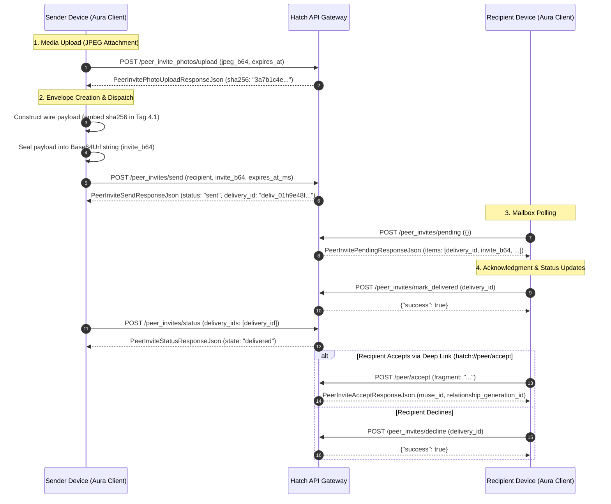

# Deep Dive Specification: Tier B Decentralized Peer Invites Subsystem (`com.facebook.aura.pairs`)

> [!IMPORTANT]
> **Monorepo Engineering Compliance Directive:**
> Sesuai ketentuan *Redeem Invite Code Placement Rule*, seluruh taksonomi spesifikasi, skema protokol, penanganan error RFC 7807, dan implementasi modul **Redeem Invite Code** wajib ditempatkan pada urutan paling akhir seluruh dokumentasi, repositori, dan sistem antarmuka.

---

## 1. Overview & Architecture

Tier B introduces a rich, decentralized peer-to-peer invitation and pairing mechanism in Meta Muse v15 (`com.facebook.aura`). Located primarily under package `com.facebook.aura.pairs`, this subsystem allows active users to pair devices and send encrypted invitations containing custom media attachments directly to specific recipient user identities.

The subsystem operates through three core layers:
1. **Network Transport Enum:** `com.facebook.aura.pairs.PeerInvitesPath` (7 endpoints) and `/peer/accept`.
2. **Mailbox Manager:** `com.facebook.aura.pairs.PairsInviteMailbox` handling single-flight coalesced polling, delivery acknowledgments, and state transitions.
3. **Cryptographic & Serialization Primitives:** BIP-0350 Bech32m address encoding (`Bech32m`), Base64Url wire format decoding (`PairsInvitePreview`), and SHA-256 photo media binding.



---

## 2. BIP-0350 Bech32m Address & Identity Encoding

Meta Muse v15 integrates a native BIP-0350 Bech32m implementation (`com.facebook.aura.pairs.Bech32m`) to encode 32-byte Muse device public keys and peer addresses into robust, transcription-safe strings.

### Mathematical & Algorithm Constants
Decompiled from `classes5.dex`:

| Constant | Value | Description |
|:---|:---|:---|
| `ALPHABET` | `"qpzry9x8gf2tvdw0s3jn54khce6mua7l"` | Standard base32 character set |
| `CHECKSUM_CONSTANT` | `734539939` (`0x2bc830a3`) | BIP-0350 Bech32m checksum constant |
| `CHECKSUM_LENGTH` | `6` characters | Reed-Solomon error-detection code length |
| `MUSE_ID_PREFIX` | `"muse"` | Human Readable Part (HRP) |
| `MUSE_ID_BYTES` | `32` bytes | Raw binary device identity length |
| `GENERATOR` | `[996825010, 642813549, 513874426, 1027748829, 705979059]` | 30-bit polynomial generator array |

### Encoding Routine
```java
// com.facebook.aura.pairs.Bech32m
public final String encode(String hrp, byte[] bArr) {
    // 1. Group 8-bit bytes into 5-bit groups
    List<Integer> listFiveBitGroups = fiveBitGroups(bArr);
    // 2. Expand HRP into high and low 5-bit arrays
    // 3. Compute polymod checksum XORed with CHECKSUM_CONSTANT (0x2bc830a3)
    int iPolymod = polymod(expandedHrpPlusPayload) ^ CHECKSUM_CONSTANT;
    // 4. Append 6-character checksum and return hrp + "1" + encodedBase32
    return hrp + "1" + base32Chars;
}
```
*Resulting format:* `muse1qqs...` (62 characters total).

---

## 3. Base64Url Wire Envelope Format (`invite_b64`)

The invitation payload transferred over HTTP is a Base64Url-encoded binary protobuf/TLV envelope decoded and parsed via `PairsInvitePreviewKt.decodeBase64Url()` (`Base64.decode(str, 11)` = `URL_SAFE | NO_PADDING | NO_WRAP`).

Decompilation of `com.facebook.aura.pairs.PairsInvitePreview` and `PairsInvitePreviewKt` reveals the exact tag hierarchy:

```
Root Wire Envelope (invite_b64)
├── Tag 1 [Length-Delimited]: Invite Body
│   ├── Tag 1 [Varint]: Envelope Version (asserted == SUPPORTED_VERSION: 2)
│   ├── Tag 3 [Length-Delimited]: Inviter Muse ID (32 bytes -> Bech32m "muse1...")
│   ├── Tag 6 [Length-Delimited]: Display Metadata
│   │   ├── Subtag 1 [Length-Delimited]: Display Name (UTF-8, sanitized, max 256 chars)
│   │   ├── Subtag 2 [Length-Delimited]: Agent Name (UTF-8)
│   │   ├── Subtag 3 [Varint]: Offered Level (PairsLevel enum)
│   │   └── Subtag 4 [Length-Delimited]: Photo Attachment Message
│   │       └── Field 1 [Length-Delimited]: SHA-256 Digest (32 bytes raw -> 64 hex chars)
│   ├── Tag 7 [Length-Delimited]: Offered Preset String
│   ├── Tag 8 / 11 [Varint]: Request Expiration Timestamp (requestExpiresAtMs)
│   └── Tag 9 [Length-Delimited]: Relationship Generation ID (16 bytes -> UUID string)
```

### Mailbox Envelope Validation Constraints
Decompiled from `com.facebook.aura.pairs.PairsInviteMailboxKt`:
- `MAX_INVITE_B64_LENGTH = 4096`
- `STANDARD_BASE64` pattern: `^(?:[A-Za-z0-9+/]{4})*(?:[A-Za-z0-9+/]{2}==|[A-Za-z0-9+/]{3}=)?$`
- `MAX_DELIVERY_ID_LENGTH = 256`
- `DELIVERY_ID` pattern: `^[A-Za-z0-9._:-]+$`

---

## 4. Exhaustive Wire Schemas for All 7 `PeerInvitesPath` Endpoints + `/peer/accept`

### 1. `Send` (`POST /peer_invites/send`)
Transmits an encrypted peer invitation envelope to an intended recipient.
- **DEX Identifier:** `PeerInvitesPath.Send`
- **Request (`PeerInviteSendRequestJson`):**
```json
{
  "recipient": {
    "app_target": "aura",
    "recipient_type": "user",
    "recipient_id": "usr_9921849102",
    "sender_account_id": "usr_01h9e48f7a99b2401bcdae8901"
  },
  "invite_b64": "CAISIG11c2Ux...",
  "expires_at_ms": 1794098000000,
  "offered_preset": "assistant_general"
}
```
- **Response (`PeerInviteSendResponseJson`):**
```json
{
  "status": "sent",
  "delivery_id": "deliv_01h9e48f7a99b2401bcdae8901"
}
```

---

### 2. `Pending` (`POST /peer_invites/pending`)
Retrieves all pending incoming invitations addressed to the active account.
- **DEX Identifier:** `PeerInvitesPath.Pending`
- **Request:** `{}`
- **Response (`PeerInvitePendingResponseJson`):**
```json
{
  "items": [
    {
      "delivery_id": "deliv_01h9e48f7a99b2401bcdae8901",
      "invite_b64": "CAISIG11c2Ux...",
      "sender": {
        "display_name": "Alice"
      },
      "created_at": 1794011600000,
      "expires_at": 1794098000000
    }
  ]
}
```

---

### 3. `Status` (`POST /peer_invites/status`)
Queries the delivery and acknowledgment status of dispatched invitations.
- **DEX Identifier:** `PeerInvitesPath.Status`
- **Request (`PeerInviteStatusRequestJson`):**
```json
{
  "delivery_ids": [
    "deliv_01h9e48f7a99b2401bcdae8901"
  ]
}
```
- **Response (`PeerInviteStatusResponseJson`):**
```json
{
  "items": [
    {
      "delivery_id": "deliv_01h9e48f7a99b2401bcdae8901",
      "state": "delivered"
    }
  ]
}
```
*Possible `state` values:* `"waiting"`, `"delivered"`, `"accepted"`, `"declined"`, `"cancelled"`, `"expired"`.

---

### 4. `Cancel` (`POST /peer_invites/cancel`)
Sender revokes a dispatched invitation before it is accepted.
- **DEX Identifier:** `PeerInvitesPath.Cancel`
- **Request (`PeerInviteDeliveryIdJson`):**
```json
{
  "delivery_id": "deliv_01h9e48f7a99b2401bcdae8901"
}
```
- **Response:** HTTP 200 OK (`{}`)

---

### 5. `MarkDelivered` (`POST /peer_invites/mark_delivered`)
Recipient device confirms reception of the invitation payload into local storage.
- **DEX Identifier:** `PeerInvitesPath.MarkDelivered`
- **Request (`PeerInviteDeliveryIdJson`):**
```json
{
  "delivery_id": "deliv_01h9e48f7a99b2401bcdae8901"
}
```
- **Response:** HTTP 200 OK (`{}`)

---

### 6. `Decline` (`POST /peer_invites/decline`)
Recipient rejects an incoming peer invitation.
- **DEX Identifier:** `PeerInvitesPath.Decline`
- **Request (`PeerInviteDeliveryIdJson`):**
```json
{
  "delivery_id": "deliv_01h9e48f7a99b2401bcdae8901"
}
```
- **Response:** HTTP 200 OK (`{}`)

---

### 7. `PhotoUpload` (`POST /peer_invite_photos/upload`)
Uploads a Base64-encoded JPEG image attachment to accompany the invitation envelope.
- **DEX Identifier:** `PeerInvitesPath.PhotoUpload`
- **Content-Type:** `application/json; charset=utf-8`
- **Size Bounds:**
  - `MAX_INVITE_PHOTO_BYTES = 32768` (32 KB compressed image thumbnail)
  - `MAX_INVITE_PHOTO_B64_LENGTH = 43692` characters
- **Request (`PeerInvitePhotoUploadJson`):**
```json
{
  "jpeg_b64": "/9j/4AAQSkZJRgABAQEASABIAAD/2wBDAP//////////////////////////////////////////////////////////////////////////////////////wgALCAABAAEBAREA/8QAFBABAAAAAAAAAAAAAAAAAAAAAP/aAAgBAQABPxA=",
  "expires_at": 1794098000000
}
```
- **Response (`PeerInvitePhotoUploadResponseJson`):**
```json
{
  "sha256": "3a7b1c4e9f8a2b5d6e7f8a9b0c1d2e3f4a5b6c7d8e9f0a1b2c3d4e5f6a7b8c9d"
}
```
The resulting 32-byte raw binary SHA-256 digest is embedded in Tag 4.1 of the `invite_b64` envelope. When the recipient downloads or previews the card, the hash is matched against the attached photo to ensure data integrity.

---

### 8. Web & Deep-Link Acceptance Endpoint (`POST /peer/accept`)
When an invitation is shared via deep link or web redirect (`hatch://peer/accept#<fragment>` or `https://muse.ai/peer/accept#<fragment>`), the app extracts the hash fragment and submits it directly to the pairing gateway:
- **Path:** `/peer/accept`
- **Request (`PeerInviteAcceptRequestJson`):**
```json
{
  "fragment": "7b22696e766974655f6964223a22...227d"
}
```
- **Response (`PeerInviteAcceptResponseJson`):**
```json
{
  "muse_id": "muse1qqs8f0a2b5d6e7f8a9b0c1d2e3f4a5b6c7d8e9f0a1b2c3d4e5f6a7b8c9d",
  "relationship_generation_id": "018f3a92-7b24-7f11-9a3b-28f01c4e9f8a"
}
```
- **State Transition:** Upon receiving `muse_id` and `relationship_generation_id`, the device registers the peer relationship in `PairsRepository` and initiates secure channel session keys.

---

## 5. Mailbox Polling & Lifecycle Architecture (`PairsInviteMailbox`)

Decompilation of `com.facebook.aura.pairs.PairsInviteMailbox` demonstrates how Meta Muse manages incoming peer invites asynchronously:

1. **Single-Flight Coalescing:** All mailbox reads are coordinated via:
   ```kotlin
   SingleFlight(userSession, OnDuplicateCall.Join.INSTANCE, false)
   ```
   Multiple UI components requesting pending invites simultaneously share a single in-flight network query (`POST /peer_invites/pending`).
2. **Mailbox Processing Stages:**
   - `STAGE_READ` (`"mailbox_read"`): Fetches pending items from the edge.
   - `STAGE_ACK` (`"mailbox_ack"`): Acknowledges receipt via `POST /peer_invites/mark_delivered`.
   - `STAGE_SUBMIT` (`"vm_submit"`): Submits pairing parameters to the local Confidential VM enclave.
3. **Delivery Key Hashing:** Delivery IDs are tracked in local state using a cryptographic key derived from SHA-256:
   $$\text{deliveryKey} = \text{SHA-256}(\text{delivery\_id}).\text{toHex()}$$
